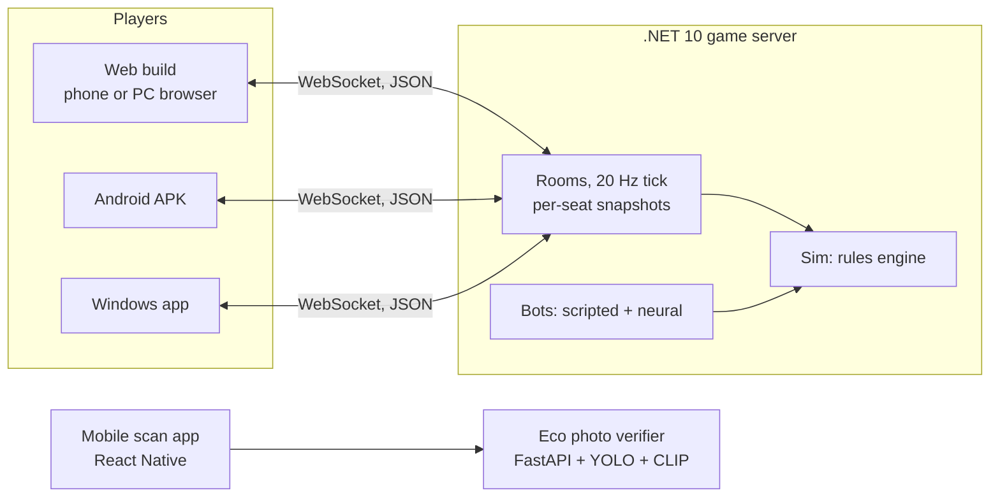

# EcoSus

An online multiplayer social-deduction game about recycling, made in 48 hours for the **Green Hackathon**
(Swedish-Tunisian Games and Innovation Days, El Ghazala, Tunisia, 21-22 November 2026).
The code name in the repository is **Uncycled**.

Eight players share a town. **Cleaners** clean dirty spots by playing short recycling mini-games and carry
the trash bags to the Recycling Machine. Two hidden **Trashers** pretend to help while they re-pollute clean
spots, jam the machine and, later, use a virus or toxic gas. Meetings and votes unmask them. AI bots fill the
empty seats, so one person can play a full round and the judges can all join the same match from their phones.

## How a round plays

| | Cleaners (6) | Trashers (2, hidden) |
|---|---|---|
| Goal | Map 100% clean, or vote out both Trashers | Survive until the timer ends, or match the Cleaners in number |
| Main action | Clean a dirty spot through its mini-game, get a bag, deliver it at the machine (+6% cleanliness), pick an upgrade | Re-pollute a clean spot (-5%) when nobody is looking |
| Extras | Backpack, Cleaning Tool, Heal, Gas Mask; heal a virus, call an alert | After 3 re-pollutes: Virus (planted in a spot) or Toxic Gas (fills a room); sabotage: smog or machine jam |
| Everyone | Dash (6 tiles, every 20 s), emergency meeting, report a fallen player, chat and vote | |

- The match lasts 7 minutes of play time; meetings pause the clock.
- Litter comes back on a spot left clean for 60 s, so there is always work.
- Every number lives in [`content/tuning.json`](content/tuning.json).
- Full rules: [`docs/design/2026-11-21-cleaners-vs-trashers.md`](docs/design/2026-11-21-cleaners-vs-trashers.md).

### Controls

| Action | Keyboard | Phone |
|---|---|---|
| Move | WASD or arrows | Left joystick |
| Use, clean, deliver | E or Space | USE button |
| Report a fallen player | R | REPORT |
| Re-pollute (Trasher) / Heal (Cleaner) | Q | button |
| Ability (Trasher) / Alert (Cleaner) | F | button |
| Sabotage (Trasher) | G | button |
| Dash | Shift | DASH |

The game is landscape only. Languages: English (default), French and Arabic, chosen in Settings.

## What is in the repository



| Path | What |
|---|---|
| [`client/`](client/) | Godot 4.7.2 client in GDScript: menu, lobby, match, meetings, results, 6 mini-games, HUD, i18n |
| [`server/Sim/`](server/Sim/) | Rules engine, engine-free C# (netstandard2.1), driven by `dt` and a seeded random |
| [`server/Uncycled.Server/`](server/Uncycled.Server/) | ASP.NET Core WebSocket server: rooms, tick loop, filtered snapshots, `/health` |
| [`bots/`](bots/) | Bot brains (scripted and ONNX policies), their tests, and the Python trainer in `bots/train/` |
| [`content/`](content/) | Shared data: tuning, maps, tasks, chat phrases, recycling taxonomy |
| [`ecoverify/`](ecoverify/), [`app.py`](app.py) | Eco photo verifier: checks a daily recycling photo, keeps streaks, CO2 totals and skins |
| [`mobile/`](mobile/) | React Native (Expo) camera app for the photo check |
| [`docs/`](docs/) | Design, protocol, architecture, team plans |

### How it works

- **Server-authoritative.** Clients send requests (`use`, `repollute`, `dash`, `vote`...). The server checks
  range and line of sight on the map grid, applies the rules and sends each seat a filtered snapshot.
  Nobody receives information they should not see: only Trashers learn who the Trashers are.
- **Movement** is predicted on the client and checked on the server (speed, walls). Other players are drawn
  from interpolated snapshots, 100 ms behind.
- **Bots use the same commands as humans.** No rule checks whether a seat is a bot. A bot takes over a
  dropped player and gives the seat back on reconnect.
- **Wire protocol:** JSON over WebSocket, version 3. Every message: [`docs/protocol.md`](docs/protocol.md).

## Run it locally

You need Docker (the server builds in the .NET 10 SDK image) and
[Godot 4.7.2 standard edition](https://godotengine.org/download/archive/4.7.2-stable/) (not the .NET edition).

**Game server** (port 5000):

```powershell
docker build -f server/Dockerfile -t uncycled-server .
docker run --rm -p 5000:8080 uncycled-server
```

Check it with `curl http://localhost:5000/health`.

**Client:** open `client/project.godot` in Godot and press Play, or run `godot --path client`.
Create a game, press Start, and bots fill the empty seats.

**Web build** (what phones use; threads off, Compatibility renderer):

```powershell
godot --headless --path client --export-release "Web" ../build/web/index.html
```

Serve `build/web` over HTTP. On a page opened over HTTPS the client connects to `wss://` on the same host;
over HTTP it connects to port 5000 of the page's host.

**Eco photo verifier** (port 8000): `docker compose up --build`, then open `http://localhost:8000`.
Details: [`ecoverify/README.md`](ecoverify/README.md).

## Tests

```powershell
# Client (Godot runner, prints TESTS PASS n)
godot --headless --path client res://tests/test_runner.tscn
```

```bash
# Server and bots (.NET runs in Docker; from the repo root in Git Bash)
MSYS_NO_PATHCONV=1 docker run --rm -v "$(pwd -W):/src:ro" mcr.microsoft.com/dotnet/sdk:10.0 \
  bash -c "cp -r /src /work && cd /work && dotnet test server && dotnet test bots"
```

Rules are covered by table-driven xunit tests; the client by its own runner; the balance was checked by
simulating full matches with 8 bots.

## Documents

| Read | For |
|---|---|
| [`docs/design/2026-11-21-cleaners-vs-trashers.md`](docs/design/2026-11-21-cleaners-vs-trashers.md) | The game as it is now (v2), balance numbers |
| [`docs/protocol.md`](docs/protocol.md) | Every network message |
| [`docs/architecture/README.md`](docs/architecture/README.md) | Diagrams: system, server, client, sequences, security |
| [`docs/team/README.md`](docs/team/README.md) | Who does what, schedule |
| [`docs/HACKATHON.md`](docs/HACKATHON.md) | Event rules and the jury grid |
| [`PROGRESS.md`](PROGRESS.md) | Current state and decisions |
| [`AGENTS.md`](AGENTS.md) | Rules for anyone (or any coding agent) changing the code |

## Team

| Who | Role |
|---|---|
| Faouzi Blibech | Team lead, Godot client gameplay, pitch |
| Mohamed Abdelhedi | Server rules, protocol, bots |
| Louay Slimi | Photo verifier, network benchmark, builds and hosting |
| Yasmin | Digital art: characters, skins, machine, spots |
| Rayen Khammar | Graphic design, UI, art integration |

## Credits

Original game, art and code made during the event. Outside assets and their licences are listed in
[`CREDITS.md`](CREDITS.md) (Noto Sans Arabic, the TACO dataset, YOLOv8, CLIP).
