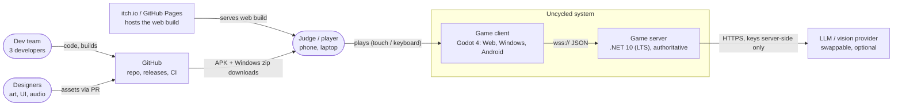
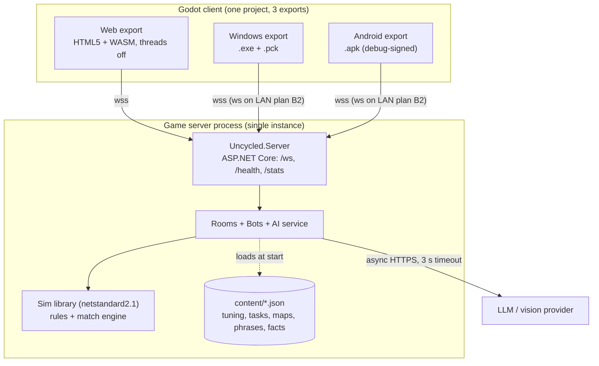
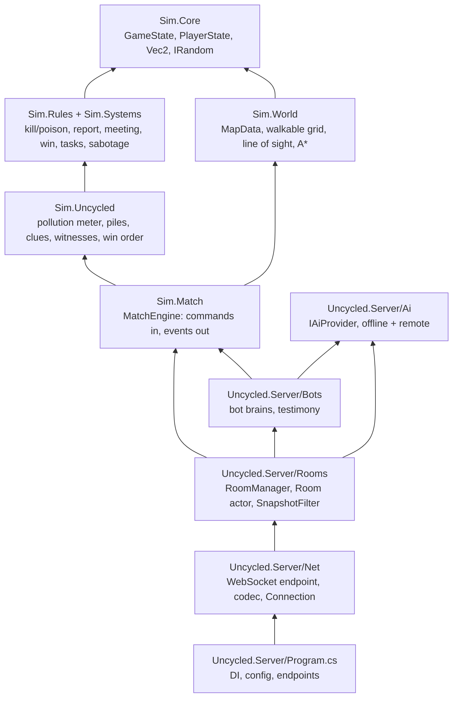
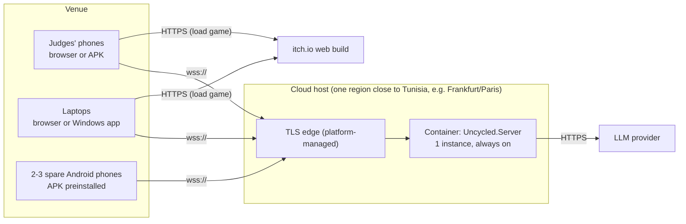
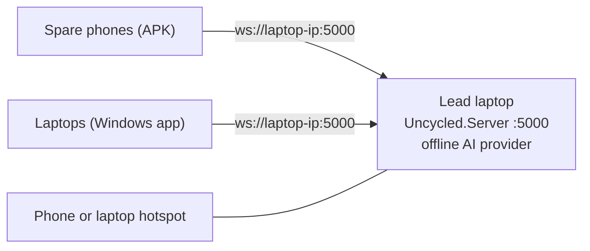

# 01 - System Context, Containers, Deployment

## 1. System context

Who and what talks to Uncycled.

## 2. Containers

Key properties:
- The **server is the only authority** for roles, tasks, poison, piles, meetings, votes and wins.
- The client is presentation + input + mini-games. It never decides an outcome.
- Content JSON is read by the server; the client receives what it needs in `welcome`.
- No database: rooms live in memory and die with the process (acceptable for the event).

## 3. Code modules and dependencies

Arrows mean "depends on". Nothing may depend upward.

Rules:
- Everything under `Sim.*` is engine-free and framework-free (no ASP.NET, no Godot, no clocks,
  no `System.Random`; only `IRandom`). It is fully unit-testable.
- `Bots` only call the same `MatchEngine` command API that humans reach through `Net`.
- `Ai` has no dependency on rooms; it returns results that the room feeds back as commands.

## 4. Deployment

### 4.1 Normal setup (event day)

### 4.2 Plan B (venue Wi-Fi fails)

| Plan | Setup | What changes |
|---|---|---|
| B1 | Devices switch to mobile data or a phone hotspot | Nothing: same cloud server, same builds |
| B2 | Server runs on a laptop (`dotnet run`), all devices on the laptop's hotspot | APK and Windows app enter `ws://<laptop-ip>:5000` in Settings; a new round starts. Web over LAN `http` only if the P0 test passed |

## 5. Runtime numbers (defaults, tunable)

| Thing | Value | Why |
|---|---|---|
| Seats per room | 8 (2 polluters) | Decided |
| Server tick | 20 Hz (50 ms) | Enough for 8 players, cheap |
| Snapshot rate | 20 Hz, filtered per seat | Smooth with a 100 ms interpolation buffer |
| Client position send | 10 Hz (`Sim` `MovementSender.SendInterval = 0.1`) | Matches the reference pacing |
| Walk speed | 2.5 tiles/s (`MovementSpeed.BaseSpeed`) = 80 px/s | Reference value, playtest later |
| Max rooms per instance | 20 | Event needs 1-3 |
| Message size cap | 4 KB | No free text exists |
