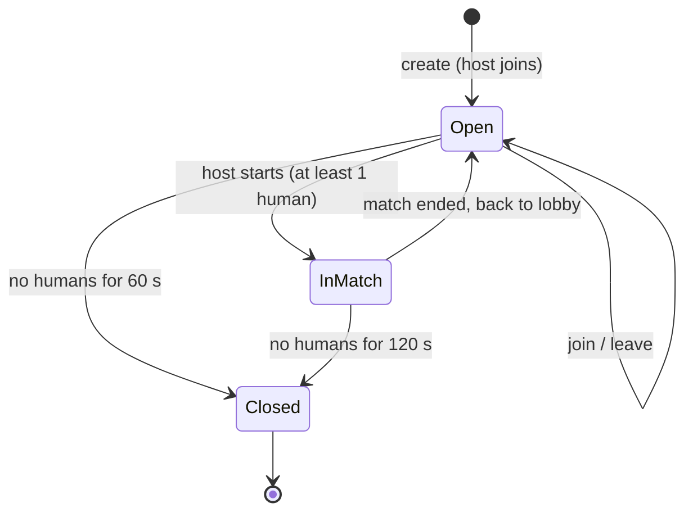
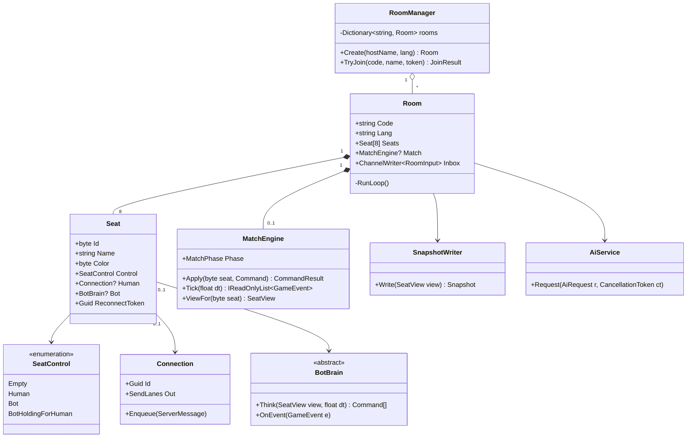
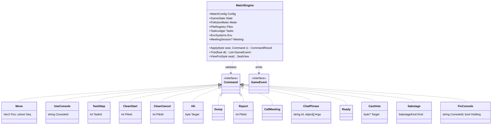
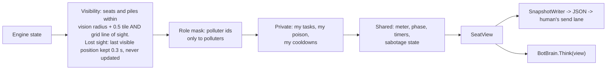

# 02 - Server

ASP.NET Core minimal API on .NET 10 (LTS). One process, one instance, rooms in memory.

## 1. Project layout

```
server/
├── Uncycled.sln
├── Sim/                         # netstandard2.1, C# 9, engine-free
│   ├── Core/                    # vendored: GameState, PlayerState, Vec2, IRandom, enums (renamed)
│   ├── Options/                 # vendored: GameOptions (trimmed, HitRange as a float)
│   ├── Roles/                   # vendored: RoleDefinition (Citizen, Polluter only)
│   ├── Rules/                   # vendored: Hit (was Kill), Meeting, Assign
│   ├── Systems/                 # vendored: HoldMeltdown (fire), SabotageCooldown
│   ├── Movement/                # vendored: MovementSpeed
│   ├── World/                   # NEW: MapData, WalkGrid, GridLineOfSight, AStar
│   ├── Uncycled/                # NEW: PollutionMeter, Poison, Piles, Clues, TaskLedger, SmogSystem, UncycledWin
│   └── Match/                   # NEW: MatchEngine, commands, events, SeatView, MatchConfig
├── Sim.Tests/                   # xunit, table-driven (vendored + new)
├── Uncycled.Server/             # net10.0
│   ├── Program.cs               # DI, config, endpoints
│   ├── Net/                     # WebSocket endpoint, Connection, JSON codec, rate limit
│   ├── Rooms/                   # RoomManager, Room (actor), Seat, SnapshotWriter, EventRouter
│   ├── Bots/                    # BotBrain, CitizenBot, PolluterBot, BotMemory, Testimony, VotePolicy
│   ├── Ai/                      # IAiProvider, OfflineProvider, RemoteProvider, AiService
│   └── Content/                 # ContentLoader
├── Uncycled.Server.Tests/       # protocol round-trips, bot soak
└── Dockerfile                   # build context = repo root (the image needs content/)
```

### 1.1 What to vendor from `reference/sim` (and what to leave)

Copy only what we use: about 900 of the 2,680 lines. Less code to rename, fewer tests to keep
green.

| Vendor (then rename) | Why |
|---|---|
| `Core/*` | State types. Trim `Enums`: `Team {Citizen, Polluter}`, `RoleId {Citizen, Polluter}`, our own game-over reasons |
| `Options/GameOptions` | Trim to the options we use; replace the `KillDistance` index with a `HitRange` float from `tuning.json` |
| `Roles/RoleDefinition` | Keep two roles |
| `Rules/Assign/RoleAssigner`, `TaskAssigner` | As-is. `TaskAssigner` de-duplicates by `TypeId`: pass the **catalog entry id** as `TypeId` so one mini-game type can be assigned at several consoles |
| `Rules/Kill/KillValidator`, `KillContext`, `KillRejectReason`, `KillTimerRules`, `ILineOfSight` | Hit validation and cooldowns (rename `Kill*` to `Hit*`) |
| `Rules/Meeting/MeetingSession` | Discussion, voting, tally. Two edits: timed-out votes count as skip; discussion can end early (Ready) |
| `Rules/Meeting/ReportValidator` | Starting point for `PileReport` and the emergency rule (it has no line-of-sight check, uses the per-player emergency count and the old round clock, and calls `WinChecker`) |
| `Systems/SystemBasics`, `SabotageCooldown`, `HoldMeltdown` (from `CriticalSabotage.cs`) | Fire sabotage |
| `Movement/MovementSpeed` | Speed constant |
| Matching tests: `AssignTests`, `KillRulesTests`, `MeetingTests`, `CriticalSabotageTests` | Trim to the vendored code |

Leave behind: `WinChecker` (replaced by `UncycledWin` + `TaskLedger`), `KillResolver`,
`ShipSystems`, `MapProfile`, `Lights`, `Comms`, `Doors`, `MushroomMixup`, `OptionPresets`, every
special role, vents, ghost roles, `PositionCodec`, `PlaybackBuffer`, `SequenceId`,
`MovementSender`. Most reference-game names live in these files, so skipping them also removes
most of the renaming work.

## 2. Components


## 3. Threading model: one actor per room

All game state of a room is touched by **one loop only**. Everything else talks to it through a
queue. This removes locks and race conditions.


Rules:
- Network handlers **only enqueue**. They never read or write `GameState`.
- `dt` is the measured time since the previous tick (a `Stopwatch` in the room loop), clamped
  to 0.25 s. `Sim` itself never reads a clock.
- `WebSocket.SendAsync` must not run concurrently on one socket: each connection has its own
  send loop. Outbound has two lanes: a **latest-snapshot slot** (a new snapshot replaces an
  unsent one) and a **reliable event queue** capped at 256; a client whose event backlog passes
  the cap is disconnected (its seat goes to a bot and it can reconnect).
- Inbound is bounded: the room inbox holds at most 1,024 inputs and each tick drains at most
  256. `move` inputs of one seat are applied **in order**, never merged: merging moves that
  arrive in a burst after a lag spike would draw a straight line through a corner and wrongly
  reject an honest player.
- One JSON object per WebSocket **message** (frames are accumulated until `EndOfMessage`);
  total message size capped at 4 KB, a message taking longer than 5 s to arrive is dropped.
- AI calls run on the thread pool; their result comes back as a `RoomInput.AiResult`.
- A room loop that throws logs the error, ends the match with a "server error" event and closes
  the room. It never takes down other rooms.

## 4. Room lifecycle



## 5. Class model (server side)



## 6. Match engine (inside `Sim`)

The engine is the whole game, engine-free. The server and the tests drive it the same way:
`Apply(seat, command)`, `Tick(dt)`, `ViewFor(seat)`.



Each wire message in `docs/protocol.md` section 4-5 maps to exactly one command.

Mapping to reused `Sim` code (renamed on vendoring):

| Engine step | Reused | New |
|---|---|---|
| Assign roles (2 polluters of 8) | `RoleAssigner.Assign` (its table gives 2 at 8 players) | a different waste-type signature per polluter |
| Assign tasks | `TaskAssigner.Assign` (every seat gets a list; polluters' lists are fakes) | `TaskLedger`: match-unique task ids, step-based totals for citizens only, reassignment of orphaned tasks |
| Validate `Hit` | `KillValidator.Validate` (range, line of sight, cooldown, meeting) | `PoisonRule`: per-victim immunity, the hit lands after a delay, out at 100% |
| Cooldowns | `KillTimerRules` (hit cooldown, reset after meeting) | dump cooldown (same pattern) |
| Report pile / emergency | ideas from `ReportValidator` (distance 3 tiles, 15 s lock) | `PileReport`: freshness, line of sight, phase; match-wide emergency count; `SinceMeeting` clock |
| Meeting + vote | `MeetingSession` (discussion, voting, results, tally) | `Missed` counted as skip; early end of discussion on Ready; spectators get the `Dead` vote kind |
| Landfill fire | `HoldMeltdown` (2 consoles held) | per-tick holder revalidation; expiry feeds the pollution meter |
| Smog | - | `SmogSystem` with timed repair |
| Clocks | - | `MatchTime`, `ActiveTime`, `SinceMeeting` (04 section 0) |
| Win check | - | `UncycledWin` (04 section 9) |

## 7. Seat views: one filter for humans and bots

`MatchEngine.ViewFor(seat)` builds a `SeatView`: everything that seat is allowed to know this
tick, and nothing else. It lives in `Sim`, so it is unit-tested without a server.



Bots never read engine state, only their `SeatView`. A leak would show up for humans and bots
alike, and a single set of tests covers both. Details of what each seat may see are in
[08-security-and-fairness.md](08-security-and-fairness.md).

## 8. Configuration

| Key | Source | Default |
|---|---|---|
| `ASPNETCORE_URLS` | env | `http://0.0.0.0:8080` (container), `http://0.0.0.0:5000` (local) |
| `UNCYCLED_CONTENT_DIR` | env | the nearest `content/` folder walking up from the working directory; `/app/content` in the container |
| `UNCYCLED_MAX_ROOMS` | env | 20 |
| `AI_PROVIDER` | env | `offline` (`remote` to enable) |
| `AI_API_KEY`, `AI_MODEL`, `AI_BASE_URL` | env / `.env` (gitignored) | unset |
| `UNCYCLED_LOG_LEVEL` | env | `Information` |

## 9. Endpoints

| Path | Use |
|---|---|
| `GET /health` | `200 ok` + build id; hosting probe and demo warm-up |
| `GET /stats` | rooms, seats, connections, tick time p95 (no personal data) |
| `GET /ws` | WebSocket upgrade; protocol in [../protocol.md](../protocol.md) |
