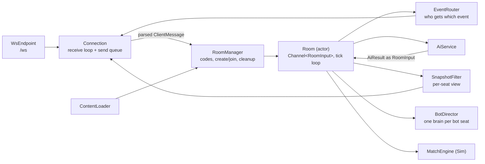
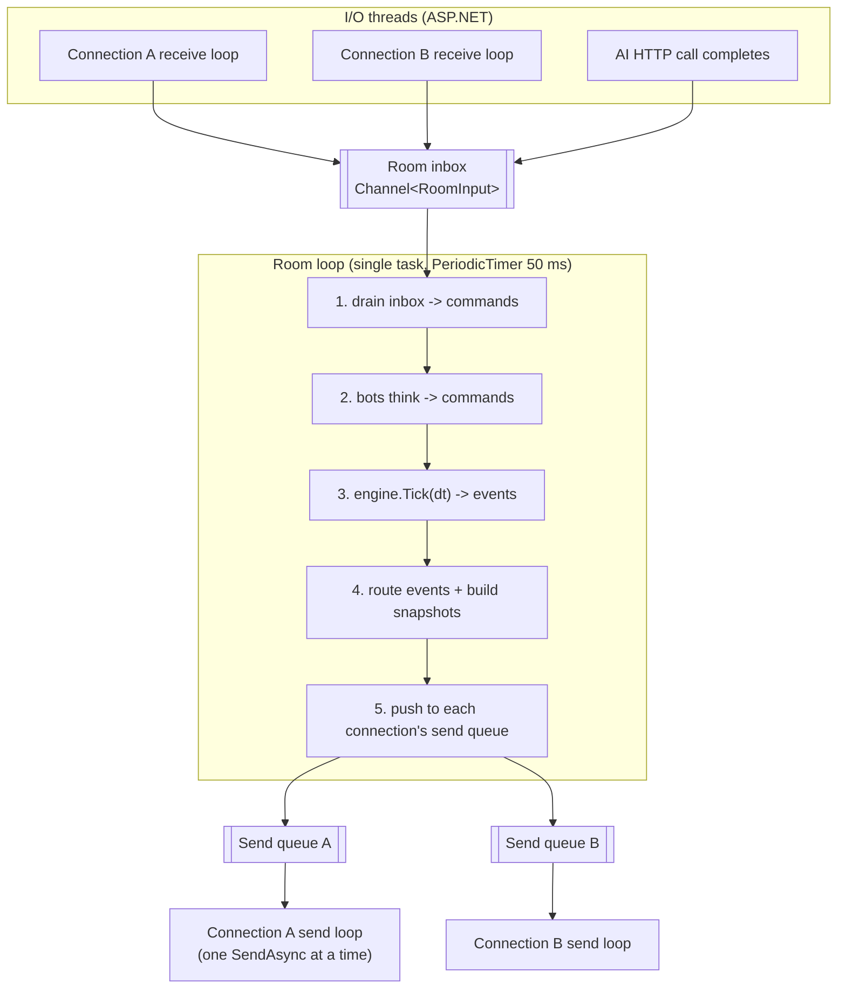
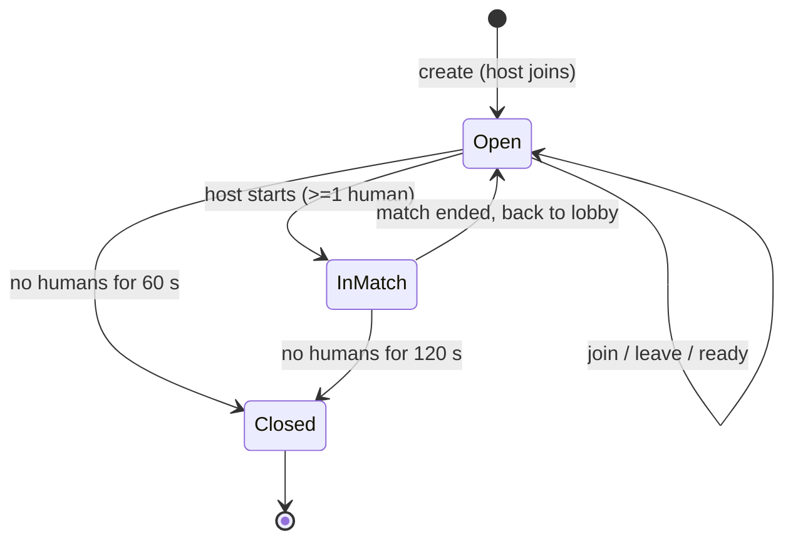
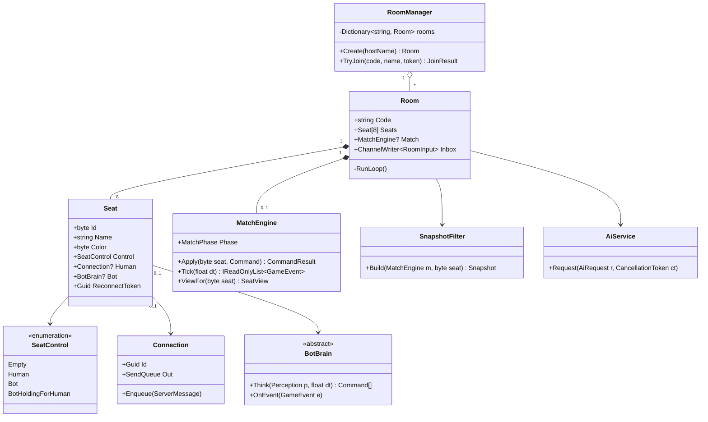
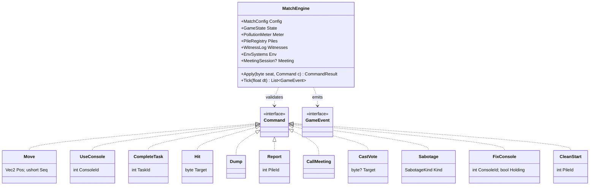
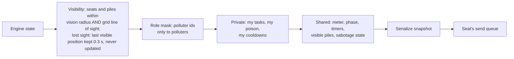

# 02 - Server

ASP.NET Core minimal API on .NET 10 (LTS). One process, one instance, rooms in memory.

## 1. Project layout

```
server/
├── Uncycled.sln
├── Sim/                         # netstandard2.1, C# 9, engine-free (vendored + extended)
│   ├── Core/                    # GameState, PlayerState, Vec2, IRandom, enums (renamed)
│   ├── Rules/                   # Kill (used for poison hits), Meeting, Win, Assign
│   ├── Systems/                 # Lights (smog), CriticalSabotage (fire), cooldowns
│   ├── Movement/                # speed formula, quantisation (later)
│   ├── World/                   # NEW: MapData, WalkGrid, GridLineOfSight, AStar
│   ├── Uncycled/                # NEW: PollutionMeter, Poison, Piles, Clues, Witnesses, UncycledWin
│   └── Match/                   # NEW: MatchEngine, commands, events, MatchConfig
├── Sim.Tests/                   # xunit, table-driven (vendored + new)
├── Uncycled.Server/             # net10.0
│   ├── Program.cs               # DI, config, endpoints
│   ├── Net/                     # WebSocket endpoint, Connection, JSON codec, rate limit
│   ├── Rooms/                   # RoomManager, Room (actor), Seat, SnapshotFilter, EventRouter
│   ├── Bots/                    # BotBrain, CitizenBot, PolluterBot, Perception, Testimony, VotePolicy
│   ├── Ai/                      # IAiProvider, OfflineProvider, RemoteProvider, AiService
│   └── Content/                 # ContentLoader (reads ../content or /app/content)
├── Uncycled.Server.Tests/       # protocol round-trips, filter tests, bot soak
└── Dockerfile
```

## 2. Components



## 3. Threading model: one actor per room

All game state of a room is touched by **one loop only**. Everything else talks to it through a
queue. This removes locks and race conditions.



Rules:
- Network handlers **only enqueue**. They never read or write `GameState`.
- `WebSocket.SendAsync` must not run concurrently on one socket: each connection has its own
  send loop. Outbound has two lanes: a **latest-snapshot slot** (a new snapshot replaces an
  unsent one) and a **reliable event queue** capped at 256; a client whose event backlog passes
  the cap is disconnected (its seat goes to a bot and it can reconnect).
- Inbound is bounded: the room inbox holds at most 1,024 inputs; each tick drains at most 256,
  and `move` inputs are coalesced (only the latest per seat is applied).
- One JSON object per WebSocket **message** (frames are accumulated until `EndOfMessage`);
  total message size capped at 4 KB, a message taking longer than 5 s to arrive is dropped.
- AI calls run on the thread pool; their result comes back as a `RoomInput.AiResult`.
- A room loop that throws logs the error, ends the match with a "server error" event and closes
  the room. It never takes down other rooms.

## 4. Room lifecycle



## 5. Class model (server side)



## 6. Match engine (inside `Sim`)

The engine is the whole game, engine-free. The server and the tests drive it the same way.



Mapping to reused `Sim` code (renamed on vendoring):

| Engine step | Reused | New |
|---|---|---|
| Assign roles (2 polluters of 8) | `RoleAssigner.Assign` | waste-type signature per polluter |
| Assign tasks | `TaskAssigner.Assign` | `TaskLedger` (step-based totals, reassignment of orphaned tasks; `WinChecker.CountTasks` not reused) |
| Validate `Hit` | `KillValidator.Validate` (range, LOS, cooldown, meeting) | `PoisonRule.Apply` (+34%, out at 100%, 25 s per-victim immunity) |
| Cooldowns | `KillTimerRules` (hit cooldown, reset after meeting) | dump cooldown (same pattern) |
| Report pile / emergency | `ReportValidator` (distance, emergency rules) | `PileReport` adapter: freshness, LOS, phase; match-wide emergency cap |
| Meeting + vote | `MeetingSession` (discussion, voting, results, tally) | `Missed` counted as skip in `Tally`; spectators get `Dead` vote kind |
| Smog sabotage | `LightsSystem.VisionRadius` formula only | `SmogSystem` with timed repair |
| Landfill fire | `HoldMeltdown` (2 consoles held) | per-tick holder revalidation; expiry feeds the pollution meter (see 04) |
| Clocks | - | `MatchTime`, `ActiveTime`, `SinceMeeting` (04 section 0) |
| Win check | `WinChecker.CountTasks`, parity logic | `UncycledWin` order with the pollution meter |

## 7. Snapshot pipeline (per tick, per seat)



Details of what each seat may see are in [08-security-and-fairness.md](08-security-and-fairness.md).

## 8. Configuration

| Key | Source | Default |
|---|---|---|
| `ASPNETCORE_URLS` | env | `http://0.0.0.0:8080` (container), `http://0.0.0.0:5000` (local) |
| `UNCYCLED_CONTENT_DIR` | env | `./content` |
| `UNCYCLED_MAX_ROOMS` | env | 20 |
| `AI_PROVIDER` | env | `offline` (`remote` to enable) |
| `AI_API_KEY`, `AI_MODEL`, `AI_BASE_URL` | env / `.env` (gitignored) | unset |
| `UNCYCLED_LOG_LEVEL` | env | `Information` |

## 9. Endpoints

| Path | Use |
|---|---|
| `GET /health` | `200 ok` + version; hosting probe and demo warm-up |
| `GET /stats` | rooms, seats, connections, tick time p95 (no personal data) |
| `GET /ws` | WebSocket upgrade; protocol in [../protocol.md](../protocol.md) |
