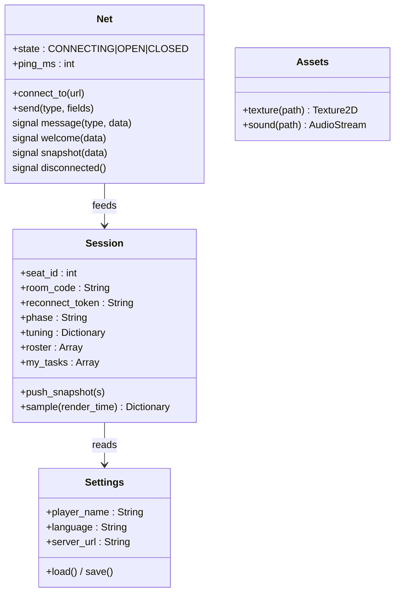
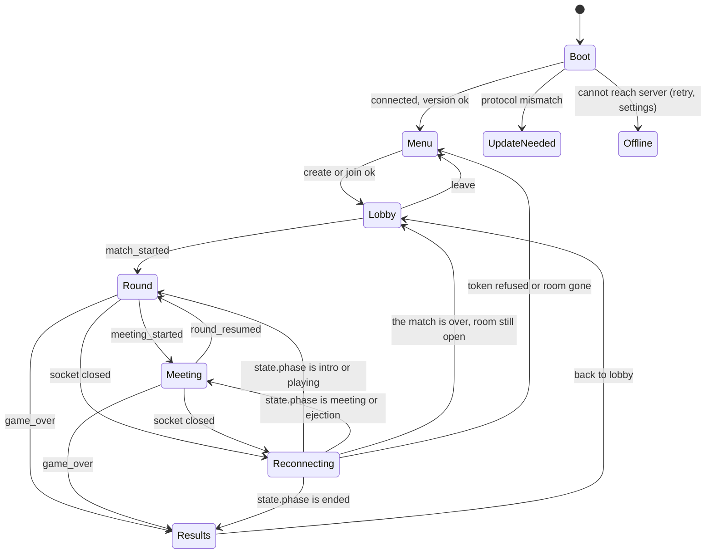
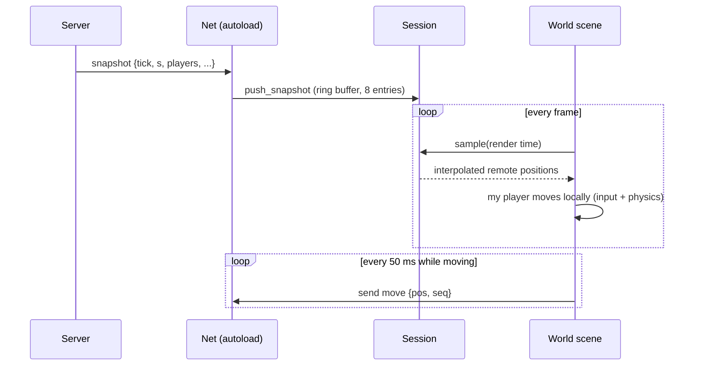
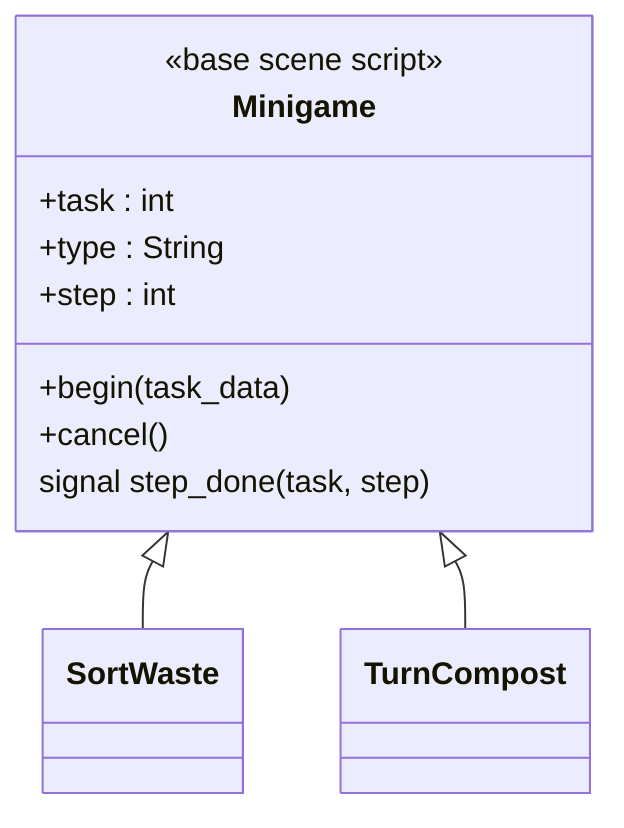

# 03 - Client (Godot 4, GDScript)

One Godot project in `client/`, Godot 4.7 standard edition (not .NET), Compatibility renderer,
exported to Web, Windows and Android.

## 1. Project layout

```
client/
├── project.godot
├── export_presets.cfg          # Web, Windows Desktop, Android (no secrets inside)
├── autoload/
│   ├── net.gd                  # WebSocketPeer, JSON codec, reconnect, one signal per message type
│   ├── session.gd              # local mirror: my seat, room, roster, phase, snapshots buffer
│   ├── settings.gd             # name, colour, language, server URL override, volume
│   └── assets.gd               # load-with-placeholder helper
├── scenes/
│   ├── boot/                   # version check, connect, route
│   ├── menu/                   # name, create / join by code, settings
│   ├── lobby/                  # seats, colours, host start button, big room code
│   ├── round/                  # world + HUD; hosts mini-games
│   ├── meeting/                # clues, player cards, accusation phrases, Ready, vote, results
│   └── results/                # winners, roles, timeline, recycling fact, back to lobby
├── world/
│   ├── maps/<map_id>.tscn      # TileMapLayer(s), consoles, spawns, zones (source of truth)
│   ├── player/player.tscn      # sprite, name label, interpolation
│   ├── pile/pile.tscn
│   ├── camera/follow_camera.gd
│   └── vision/vision.gd        # darkness + player light, smog shrink
├── ui/
│   ├── hud/                    # task list, meter, buttons (use, report, clean, hit, dump, sabotage)
│   ├── joystick/               # virtual stick
│   └── widgets/                # buttons, toasts, timer, rotate-your-phone overlay
├── minigames/
│   ├── minigame.gd             # base contract (below)
│   └── <type>/                 # one folder per mini-game type
├── tools/
│   └── export_map.gd           # headless: maps/*.tscn -> ../content/maps/*.json
├── i18n/
│   └── strings.csv             # keys, en, fr (Godot translation import)
└── assets/                     # designers; placeholders until real art
```

## 2. Autoloads



Rules:
- Only `Net` touches the socket. Scenes subscribe to `Net` signals and read `Session`.
  `Net.message(type, data)` fires for every message; the typed signals are shortcuts for the
  hot ones.
- `Net` converts tiles to pixels (x 32) on the way in and pixels to tiles on the way out.
  Nothing else in the client knows about tile units.
- `Settings` persists to `user://settings.cfg`; `Session.reconnect_token` to `user://session.cfg`.
- `Assets.texture()` returns a coloured placeholder and logs a warning if the file is missing.

## 3. Scene flow



## 4. Net layer and timing



- The client sends `move` at the server tick rate (20 Hz). Sending slower than the snapshot
  rate would make remote players move in a stop-go pattern.
- Server time offset: `offset = s - local_t`, smoothed over snapshots; render time is
  `local_now + offset - 100 ms`.
- Own player: moved locally. If the server sends `correct {pos}` (rejected move), snap there.
- Remote players: interpolate between the two snapshots around render time; never extrapolate
  more than 200 ms; hide a player who is no longer in the snapshot (out of sight).
- Reconnect: exponential backoff 0.5, 1, 2, 4 s (up to 30 s in total), then `hello` + `join`
  with the token.

## 5. Input

| Action | Touch | Keyboard / mouse |
|---|---|---|
| Move | Virtual joystick (left half of screen) | WASD / arrows |
| Use / do task | Context button (bottom right) | E |
| Report pile | Report button (shown near a fresh pile) | R |
| Clean pile | Clean button near a dump pile, hold 3 s | C (hold) |
| Hit (polluter) | Hit button with cooldown ring, enabled within 1.5 tiles of a citizen | Q |
| Dump (polluter) | Dump button with cooldown ring | F |
| Sabotage (polluter) | Sabotage menu button | Tab |
| Emergency meeting | Use the meeting console in the map, then confirm | E on console |
| Accuse / clear (meeting) | Tap a player card, pick a phrase | Click |
| Ready (meeting) | Ready button | Space |
| Vote | Tap a player card or Skip, confirm | Click |

Touch targets at least 48 px on the 640x360 logical screen. Buttons only show when usable;
cooldowns are drawn from snapshot values, never computed alone on the client.

## 6. Mini-game contract



- Opened by the HUD when the server answers `use_ok {kind: task}`.
- When the player finishes a step the HUD sends `task_step`; the server validates console,
  range, minimum duration and assignment, and answers `task_progress`. The mini-game never
  marks a task done locally.
- A mini-game closes if the player moves away, a meeting starts or the player is out.
- Polluters need no special code: the server gave them a fake task list, and their `use` and
  `task_step` behave the same but never count.

## 7. Rendering and vision

- Logical 640x360, stretch mode `canvas_items`, aspect `expand`, pixel snap on.
- Vision: `CanvasModulate` darkens the world; a `PointLight2D` with shadows on the player
  (radius = `me.vision` from the snapshot) lights it; walls carry `LightOccluder2D`, so light
  stops at walls. This is cosmetic: the server already filters out what you cannot see.
  Check 2D shadows in the Compatibility renderer on a real phone in P1. Fallback if they are too
  slow: a plain circle mask without wall shadows (the server filter still hides players).
- Smog: the radius shrinks to the snapshot value with a tween.
- Poison: only **your own** level is shown (bar + green screen tint). A hit shows nothing when
  it happens; `poisoned` arrives 5 s later with an alert.
- Dump cue: `cue {kind: dump, seat, pos}` plays the dump animation on that player; it only
  arrives if you could see it.
- Spectators (out): a "you are out, please stay quiet" screen with meter, phase and meetings; no map.
- Task bar: only shown during meetings (`task_bar` arrives in `meeting_started`).
- Phones in portrait: show a "rotate your phone" overlay (a web page cannot lock orientation).

## 8. Joining a room

The lobby shows the 4-letter room code in large type. Players open the game (one fixed web
link, or the app) and type the code. A printed or on-screen **QR code of the web link** gets
phones to the game quickly; it is the same for every room, so the client needs no QR generator.

## 9. Platform differences

| Topic | Web | Windows | Android |
|---|---|---|---|
| Server URL | Build-time default `wss://...` | Default + Settings override | Default + Settings override |
| Audio | Starts after first tap | Immediate | Immediate |
| Fullscreen | Button (browser gesture) | Start fullscreen | Always fullscreen landscape |
| Permissions | none | none | `INTERNET` (+ `CAMERA` only if the scanner AI feature is chosen) |
| Storage | `user://` = IndexedDB | AppData | app storage |
| Known limits | Needs WebGL 2; iPhone Safari tested every phase | - | Back button = leave confirm |
