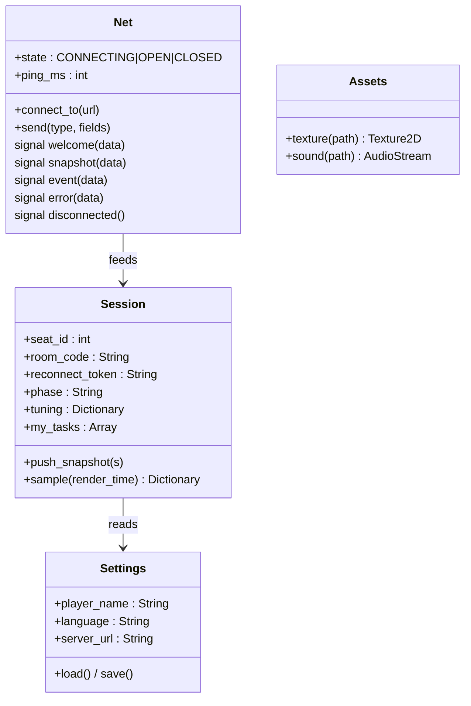
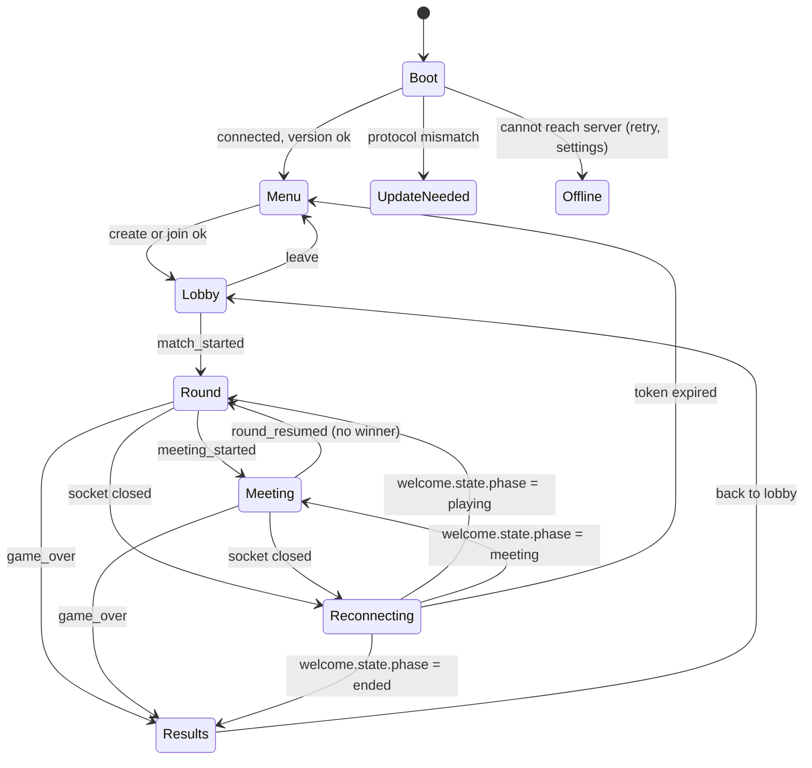
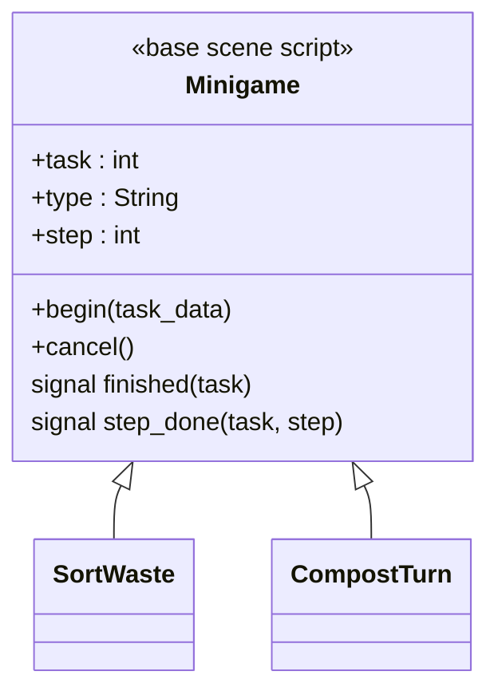

# 03 - Client (Godot 4, GDScript)

One Godot project in `client/`, standard edition (not .NET), Compatibility renderer, exported to
Web, Windows and Android.

## 1. Project layout

```
client/
├── project.godot
├── export_presets.cfg          # Web, Windows Desktop, Android (no secrets inside)
├── autoload/
│   ├── net.gd                  # WebSocketPeer, JSON codec, reconnect, signals per message type
│   ├── session.gd              # local mirror: my seat, room, phase, snapshots buffer
│   ├── settings.gd             # name, colour, language, server URL override, volume
│   └── assets.gd               # load-with-placeholder helper
├── scenes/
│   ├── boot/                   # version check, connect, route
│   ├── menu/                   # name, create / join by code, settings
│   ├── lobby/                  # seats, colours, host start button, room code + QR
│   ├── round/                  # world + HUD; hosts minigames
│   ├── meeting/                # discussion, vote cards, results
│   └── results/                # winners, debrief, recycling fact, back to lobby
├── world/
│   ├── maps/<map_id>.tscn      # TileMapLayer(s), consoles, spawns, zones (source of truth)
│   ├── player/player.tscn      # sprite, name label, poison tint, interpolation
│   ├── pile/pile.tscn
│   ├── camera/follow_camera.gd
│   └── vision/vision_mask.gd   # fog/vision circle, smog shrink
├── ui/
│   ├── hud/                    # task list, meter, buttons (use, report, hit, dump, sabotage)
│   ├── joystick/               # virtual stick
│   └── widgets/                # buttons, toasts, timer
├── minigames/
│   ├── minigame.gd             # base contract (below)
│   └── <task_type>/            # one folder per eco task
├── tools/
│   └── export_map.gd           # headless: maps/*.tscn -> ../content/maps/*.json
├── i18n/
│   └── strings.csv             # keys, en, fr (Godot translation import)
└── assets/                     # designers; placeholders until real art
```

## 2. Autoloads



Rules:
- Only `Net` touches the socket. Scenes subscribe to `Net` signals and read `Session`.
- `Settings` persists to `user://settings.cfg`; `Session.reconnect_token` to `user://session.cfg`.
- `Assets.texture()` returns a coloured placeholder and logs a warning if the file is missing.

## 3. Scene flow



## 4. Net layer and timing


- Server time offset: `offset = server_t - local_t` smoothed over snapshots; render time is
  `local_now + offset - 100 ms`.
- Own player: predicted locally. If the server sends `correct {pos}` (rejected move), snap there.
- Remote players: interpolate between the two snapshots around render time; never extrapolate
  more than 200 ms; hide a player whose updates stop (out of vision).
- Reconnect: exponential backoff 0.5, 1, 2, 4 s (max 30 s total), then `join` with token.

## 5. Input

| Action | Touch | Keyboard / mouse |
|---|---|---|
| Move | Virtual joystick (left half of screen) | WASD / arrows |
| Use / do task | Context button (bottom right) | E |
| Report pile | Report button (shown near a pile) | R |
| Clean pile (citizen) | Clean button near a dump pile, hold 3 s | C (hold) |
| Hit (polluter) | Hit button with cooldown ring | Q |
| Dump (polluter) | Dump button with cooldown ring | F |
| Sabotage (polluter) | Sabotage menu button | Tab |
| Emergency meeting | Press the meeting console in the map | E on console |
| Vote | Tap a player card, confirm | Click |

Touch targets at least 48 px on the 640x360 logical screen. Buttons only show when usable;
cooldowns are drawn from snapshot values, never computed alone on the client.

## 6. Mini-game contract



- Opened by the HUD when the server confirms `use` on the right console (`use_ok`).
- On success the HUD sends `task_step` / `task_complete`; the server validates console, range and
  assignment. The mini-game never marks a task done locally.
- A mini-game closes if the player moves away, a meeting starts or the player is out.
- Polluters can open a "fake" version: same UI, nothing is sent (they fake tasks).

## 7. Rendering and vision

- Logical 640x360, stretch mode `canvas_items`, aspect `expand`, pixel snap on.
- Vision: `CanvasModulate` darkens the world; a `PointLight2D` with shadows on the player
  (radius = `vision` from the snapshot) lights it; walls carry `LightOccluder2D`, so light and
  sight stop at walls. This is cosmetic: the server already filters out what you cannot see.
  Confirm 2D shadows in the Compatibility renderer on a phone in P1.
- Smog: radius shrinks to the snapshot value with a tween.
- Poisoned players: green tint scales with **your own** poison only (others' poison is not sent).
- Cues: `cue {kind: hit|dump, seat, pos}` plays a short effect; it only arrives if you could see it.
- Spectators (out): a "you are out, please stay quiet" screen with meter, phase and meetings; no map.
- Task bar: only shown during meetings (`task_bar` arrives in `meeting_started`).

## 8. Platform differences

| Topic | Web | Windows | Android |
|---|---|---|---|
| Server URL | Build-time default `wss://...` | Default + Settings override | Default + Settings override |
| Audio | Starts after first tap | Immediate | Immediate |
| Fullscreen | Button (browser gesture) | Start fullscreen | Always fullscreen landscape |
| Permissions | none | none | `INTERNET` (+ `CAMERA` only if the scanner AI feature is chosen) |
| Storage | `user://` = IndexedDB | AppData | app storage |
| Known limits | Needs WebGL 2; iPhone Safari tested every phase | - | Back button = leave confirm |
