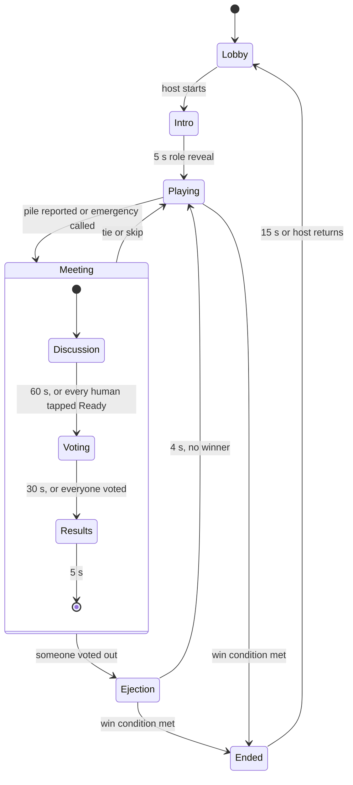
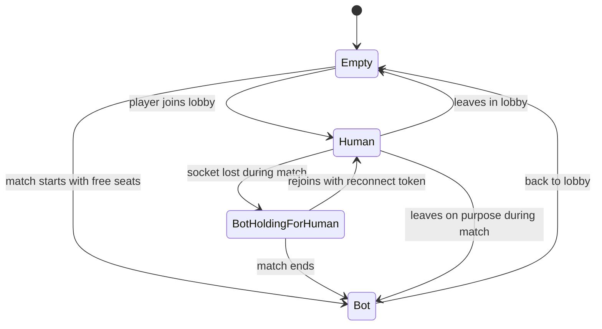
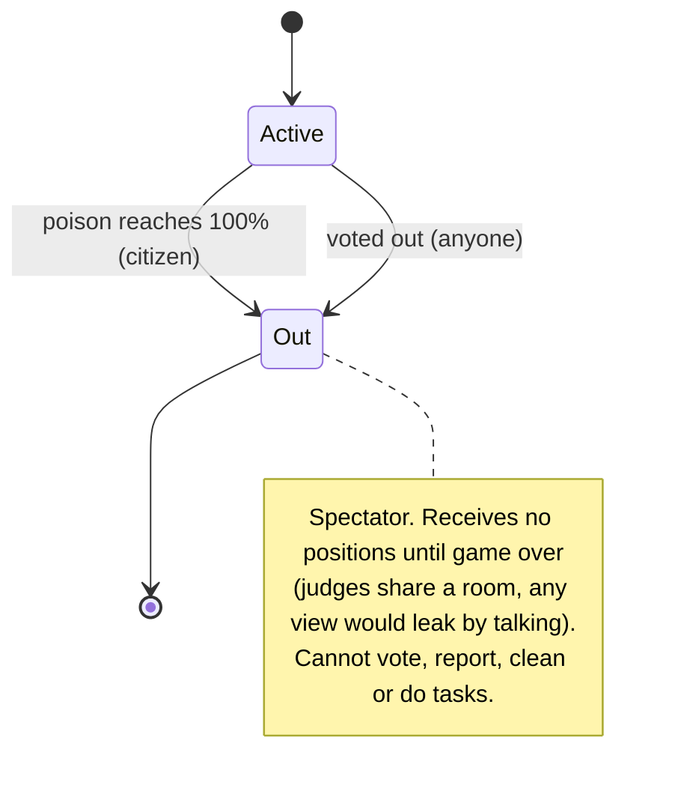
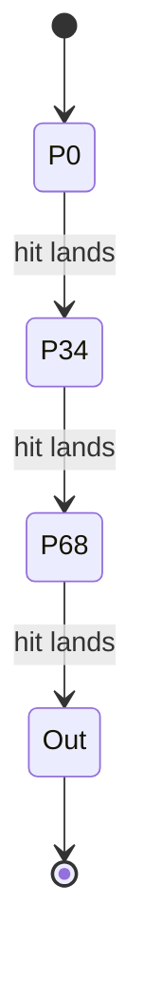
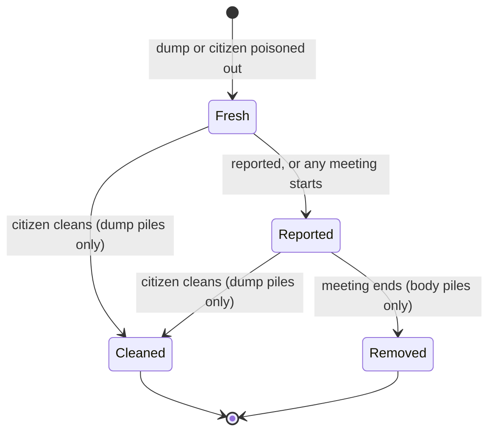
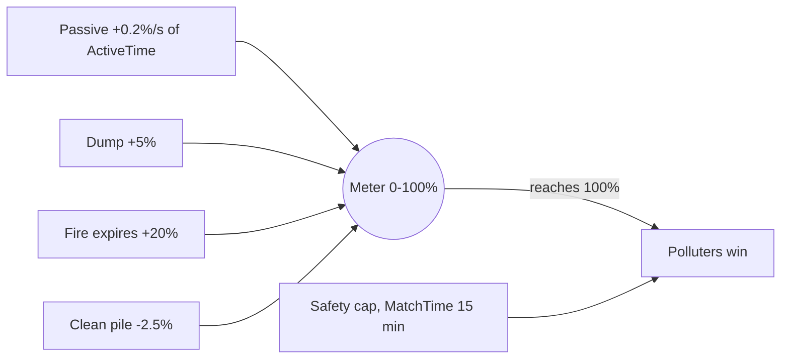
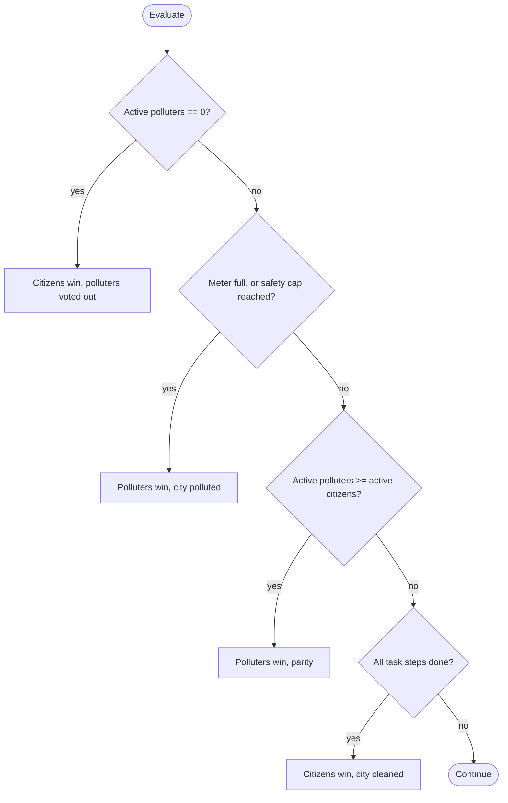

# 04 - Game Rules as State Machines

**This file is the source of truth for rules and numbers.** Other docs point here instead of
repeating values. Every rule is implemented in `server/Sim` (engine-free) and covered by
table-driven tests. Numbers are **starting values** in `content/tuning.json`; playtests will
change them.

Status of the rules: the owner decided the core (2 polluters of 8, vote kick-out, poison hits,
free dump + witness, humans chat by phrases or typed text + bot phrases, 60 s talk + 30 s vote). Everything else here is a
**proposal for the team to confirm** (see `PROGRESS.md`).

## 0. Three clocks

`Sim`'s `GameState.RoundTime` resets after each meeting, which is wrong for evidence. We keep
three separate clocks:

| Clock | Runs during | Drives |
|---|---|---|
| `MatchTime` | everything after Intro (meetings included), never resets | clue timestamps, timeline, the safety cap |
| `ActiveTime` | `Playing` only | passive meter rise, hit / dump / sabotage cooldowns |
| `SinceMeeting` | `Playing` only, resets at each meeting end | emergency minimum wait |

## 1. Match phases

On meeting **start**: every fresh pile becomes `Reported` (all their clues are shown, so reports
cannot chain), an active fire is cleared, open mini-games and clean actions are cancelled.

On meeting **end** (back to `Playing`): hit and dump cooldowns reset to their full value, the
sabotage cooldown resets to 10 s, everyone teleports to spawns, body piles are removed, dump
piles stay.

## 2. Seat control (who drives a seat)

A seat in `BotHoldingForHuman` is still a normal active player for every rule (counts, votes,
tasks). `Sim`'s `Disconnected` flag is never set for it. Rejoining replaces the old connection
atomically (the old socket, if still half-open, is closed).

## 3. Player status in a match

**Open decision (owner):** an out player currently watches a waiting screen until the round
ends, which can be several minutes for a judge. The alternative is the genre's usual answer:
out players become invisible "volunteers" who keep doing their tasks and cleaning piles with
normal vision, but cannot vote or report. It keeps judges playing and removes task
reassignment (section 9). See `PROGRESS.md`.

## 4. Poison (citizens only)

| Rule | Value / source |
|---|---|
| Poison per hit | 34% (3 hits to be out) |
| Hit validation | Renamed `KillValidator`: attacker is an active polluter, cooldown done, target is an active citizen, range <= 1.8 tiles, line of sight, phase `Playing`; **plus** target not inside its immunity window |
| Hit cooldown | 25 s per polluter on `ActiveTime`, 10 s at match start, reset to 25 s after meetings |
| Per-victim immunity | 25 s after any hit, from either polluter (stops two polluters stacking hits) |
| **The hit is covert** | Nothing is shown when the polluter hits. The hit **lands 5 s later**: only then does the victim's bar rise, with a "you have been poisoned" alert. Nobody else is told, ever |
| Who sees poison | Only the victim (own bar) |
| Healing | None |
| Reaching 100% | When the third hit lands the citizen goes `Out` and a **body pile** appears where they stand |

Why covert and delayed: if the victim saw the hit, every hit would name the attacker and
polluters would never use it. With the delay the victim only knows "it happened around here,
these players were near me", which is a claim others must weigh (and a polluter can fake it).

Range note: 1.8 tiles is the reference game's default. The client shows the Hit button at 1.5
tiles so that network delay rarely causes a rejected hit.

## 5. Piles

| Rule | Value |
|---|---|
| Dump | Active polluter, cooldown 40 s (10 s at match start), phase `Playing`; a dump pile appears at their feet. The dump is **visible**: seats with vision + line of sight on the polluter get a dump cue |
| Meter on dump | +5% |
| Clean | Any active citizen or polluter: `clean_start {pile}`, the server completes it after 3 s if the cleaner stays in range, active, not in a meeting, and nobody else is cleaning that pile; -2.5% meter. Not part of the task bar |
| Report | Active seat, pile `Fresh`, range 3 tiles + line of sight, phase `Playing`; allowed during a fire (the meeting clears the fire) |
| Clue (dump pile) | zone, `MatchTime` of creation, waste type = the dumper's signature |
| Clue (body pile) | zone, `MatchTime`, victim; **no** waste type |
| Signatures | Each polluter gets a different waste type at match start (drawn without replacement), so matching dump piles mean the same polluter |

## 6. What can be witnessed

| Act | Visible to | Recorded for bots |
|---|---|---|
| Dump | Every active seat with the polluter inside its vision radius **and** line of sight gets `cue {kind: dump, seat, pos}` and sees the pile | Same seats, as "saw X dump" |
| Hit | Nobody | The victim's own memory only: who was within hit range in the 8 s before the hit landed |
| Fake task | Looks exactly like a real task | - |

Bots and humans get exactly the same observations: both read the same per-seat view
(`SeatView`, see 02). The server never tells a human "you witnessed X", and witness lists are
never printed in the UI.

## 7. Pollution meter: the round's clock

The meter is the only real time limit, and it only moves during play (meetings pause it), so
calling a meeting never costs the citizens the game.

| Scenario | Rate | Active play until full |
|---|---|---|
| No dumps at all | 0.2%/s | 8 min 20 s |
| Realistic: one dump per polluter per minute, half of them cleaned | about 0.33%/s | about 5 min |
| Both polluters dump on cooldown, every pile cleaned | 0.325%/s | 5 min 10 s |
| Both polluters dump on cooldown, nothing cleaned | 0.45%/s | 3 min 40 s |

Expected round: **4 to 6 minutes of play plus 1 to 1.5 minutes per meeting**, so 6 to 10
minutes in total with two or three meetings. The 15-minute cap is a safety net against stalling
and should never trigger in a normal round.

If the team wants rounds closer to 6 minutes in total, raise `passive_per_s` and shorten the
meeting timers; both are in `tuning.json`.

## 8. Sabotage

| Sabotage | Built on | Effect | Fix |
|---|---|---|---|
| Landfill fire (SHOULD) | `HoldMeltdown` (2 consoles) | 45 s countdown, alarm; emergency button blocked | Two players hold both consoles at the same time (any active seat may hold, polluters included). **Holders are revalidated every tick** (range, line of sight, active, still holding) and released immediately when invalid |
| Smog (COULD) | new `SmogSystem` | Citizen vision eases down to 1 tile over 2 s; polluters unaffected | One player holds the smog panel for 3 s |
| Cooldown | `SabotageCooldown` | 10 s at match start and after meetings; 30 s after a sabotage, counted from its **end** (the library freezes the timer while one is active) | - |

Fire expiry does **not** end the round directly: it adds +20% to the meter and stops.

## 9. Tasks and win evaluation

Task catalog: `content/tasks.json` holds **entries**; an entry is one mini-game type at one
place (for example "sort waste at the market bins"). Two mini-game types at several consoles
give enough entries. The assigner picks per seat: 1 common + 2 short + 1 long (2 steps), so 5
steps per citizen and 30 steps for 6 citizens.

Task accounting (new code, `Sim.Uncycled.TaskLedger`):
- Progress is counted in **steps**. The total is fixed at match start and counts citizens only.
- Polluters also get a task list from the assigner. Their tasks work exactly the same on the
  wire (`use`, `task_step`) but never count: that is how they fake tasks.
- When a citizen goes `Out`, their completed steps still count; each **unfinished** task is
  reassigned to the active citizen with the fewest remaining tasks (`task_added`). The total
  never shrinks, so ejecting an idle citizen can never win the game for the citizens.
- The task bar is published **only at meetings**, so watching the bar cannot expose a polluter
  faking a task.

Evaluated after every event that changes counts, meter or tasks (not mid-meeting; after results).

## 10. Meeting rules

| Rule | Value / source |
|---|---|
| Triggers | Report a fresh pile, or the emergency console |
| Emergencies | **2 per match in total** (shared), not in the first 15 s after a meeting, not during fire |
| Discussion | Up to 60 s. Ends early (after a 10 s minimum) when every active **human** has tapped Ready; bots are always ready |
| Voting / results | 30 s (ends early when everyone voted) / 5 s |
| Talking | Humans chat by phrases or typed text. Bots post short phrases. A typed line is at most 120 characters, 5 typed lines per seat per meeting (separate from the 5 phrases), at least 2 s between two chat lines of a seat, and listed words are replaced by `***`. Humans can also tap a player card to post an accusation phrase: that is how humans **tell the bots** what they saw (see 06). Out players have a ghost chat among themselves (typed or phrases, any time of the match); living players never receive it |
| Who votes | Active seats (bots included). `Out` seats get `VoteKind.Dead` |
| Timed-out votes | Count as **skip** (change in `MeetingSession.Tally`, which ignores `Missed` today), so two polluters cannot eject a citizen while others time out |
| Result | Plurality kicks out; a tie or a skip majority kicks out nobody |
| Confirm eject | On: the ejection screen says if the player was a polluter |
| Clues shown | Clues of every pile that became `Reported` at this meeting's start |
| Task bar | Shown at meeting start |

## 11. Scope tiers (what to cut first)

| Tier | Rules |
|---|---|
| MUST | rooms + lobby, movement, roles, 2 mini-game types, dump, meter, cleaning, poison, report, meeting + vote + Ready, wins, basic bots (walk, tasks, dump, clean, vote, listen to accusations), reconnect (token + phase restore), 3 exports |
| SHOULD | clues + signatures, landfill fire, bot testimony phrases, debrief with a recycling fact |
| COULD | smog, AI rewrite of bot lines, AI debrief, French strings, a late joiner taking over a bot seat |

Cutting order under pressure: drop COULD first, then SHOULD from the bottom up. Never cut a
MUST to keep a SHOULD.
