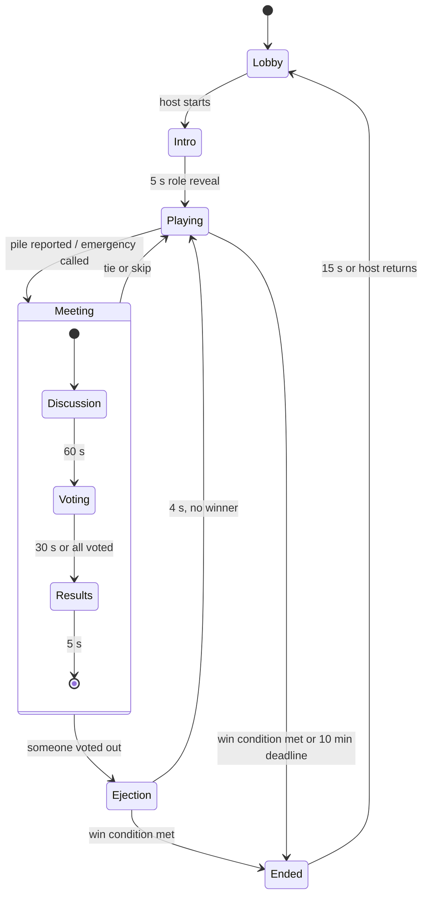
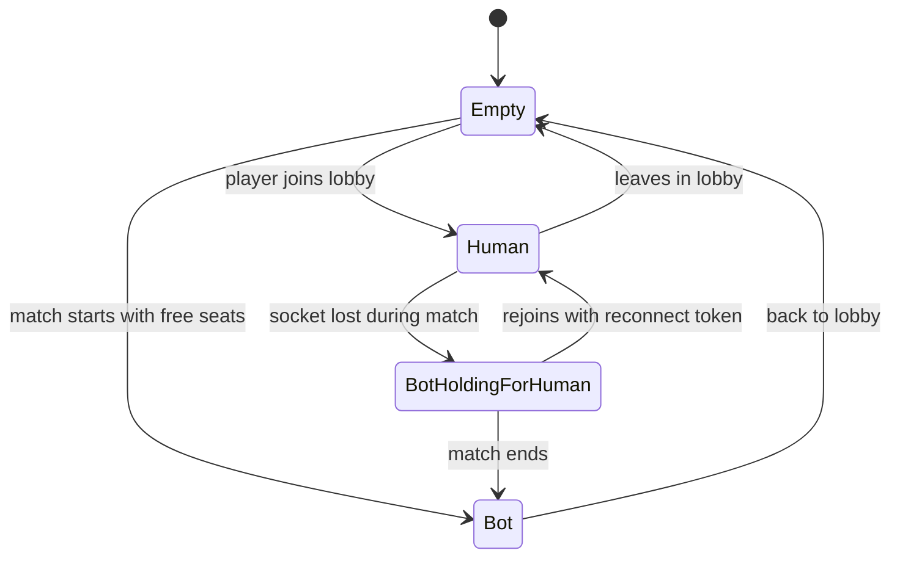
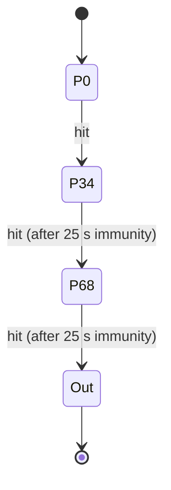
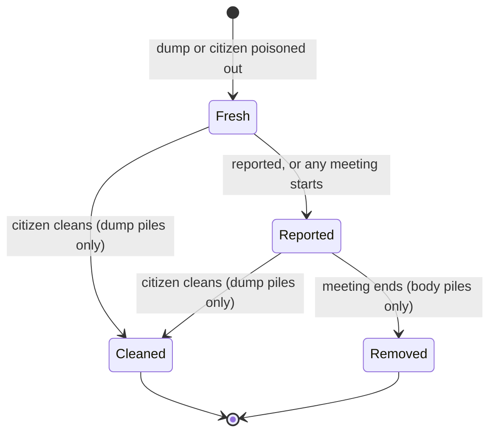
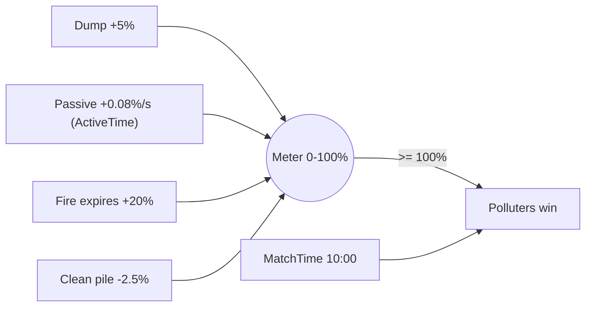

# 04 - Game Rules as State Machines

Every rule here is implemented in `server/Sim` (engine-free) and covered by table-driven tests.
Numbers are **starting values** in `content/tuning.json`; playtests will change them.

## 0. Three clocks

`Sim`'s `GameState.RoundTime` resets after each meeting, which is wrong for evidence. We keep
three separate clocks:

| Clock | Runs during | Drives |
|---|---|---|
| `MatchTime` | everything after Intro (meetings included), never resets | clue timestamps, timeline, the 10:00 hard deadline |
| `ActiveTime` | `Playing` only | passive meter rise, hit/dump/sabotage cooldowns |
| `SinceMeeting` | `Playing` only, resets at each meeting end | emergency minimum wait (`ReportValidator.MinEmergencyRoundTime`) |

## 1. Match phases

On meeting **start**: every fresh pile becomes `Reported` (all their clues are shown, so reports
cannot chain), an active fire is cleared (as `Sim` `ShipSystems.BeginMeeting` does), open
mini-games and clean actions are cancelled.

On meeting **end** (back to `Playing`): hit/dump cooldowns reset (`KillTimerRules.ResetAfterMeeting`),
everyone teleports to spawns, body piles are removed, dump piles stay.

## 2. Seat control (who drives a seat)

A seat in `BotHoldingForHuman` is still a normal active player for every rule (counts, votes,
tasks). `Sim`'s `Disconnected` flag is never set for it. Rejoining replaces the old connection
atomically (the old socket, if still half-open, is closed).

## 3. Player status in a match

## 4. Poison (citizens only)

| Rule | Value / source |
|---|---|
| Poison per hit | 34% (3 hits to be out) |
| Hit validation | `KillValidator.Validate`: attacker active polluter, cooldown done, target active citizen, range <= 1.0 tile, line of sight, no meeting; **plus** target not inside its immunity window |
| Hit cooldown | 25 s per polluter on `ActiveTime`, 10 s at match start, reset after meetings |
| Per-victim immunity | 25 s after any hit, from either polluter (stops 2 polluters stacking hits) |
| Who sees poison | Only the victim (own bar). A victim's accusation is an unverifiable claim |
| Hit cue | A short "toxic puff" effect at the victim, sent to every seat that has the victim in vision + LOS (same decision used for bot witnesses) |
| Healing | None |
| On reaching 100% | Citizen goes `Out`; a **body pile** appears; their unfinished tasks are reassigned (section 9) |

## 5. Piles

| Rule | Value |
|---|---|
| Dump | Active polluter, cooldown 40 s, phase `Playing`; dump pile at their feet; a dump cue is sent to seats with vision + LOS |
| Meter on dump | +5% |
| Clean | Optional action, not part of the task bar: `clean_start {pile}`, server completes after 3 s if the cleaner stays in range, active, not in a meeting, and nobody else is cleaning that pile; -2.5% meter |
| Report | Active seat, pile `Fresh`, range 3 tiles + LOS, phase `Playing`; allowed during a fire (the meeting clears the fire) |
| Clue (dump pile) | zone, `MatchTime` of creation, waste type = the dumper's signature |
| Clue (body pile) | zone, `MatchTime`, victim; **no** waste type |
| Signatures | Each polluter gets a different waste type at match start (drawn without replacement), so matching dump piles mean the same polluter |

## 6. Witnesses and cues

At the moment of a **dump** or a **hit**, every other active seat that has the actor within its
vision radius **and** line of sight:
- gets the visual cue (client shows it; humans see who did it if they are looking),
- is recorded as a witness (server-side, bots use it for testimony).

Bots and humans get exactly the same observation; the server never tells a human "you
witnessed X", and witness lists are never printed in the UI.

## 7. Pollution meter and deadline

Balance check (2 polluters dumping on cooldown): dumps 2 x 5/40 = 0.25%/s + passive 0.08%/s =
0.33%/s, so about **5 minutes of active play** with no cleaning, about **8 minutes** if citizens
clean every pile. Meetings eat `MatchTime`, so calling many meetings runs the clock toward the
polluters' deadline win.

## 8. Sabotage

| Sabotage | Built on | Effect | Fix |
|---|---|---|---|
| Smog (COULD) | new `SmogSystem`; vision from `LightsSystem.VisionRadius` formula | Citizen vision eases down to 1 tile over 2 s; polluters unaffected | One citizen holds the smog panel 3 s (timed repair; `Sim`'s 5-switch puzzle is not used) |
| Landfill fire (SHOULD) | `HoldMeltdown` (2 consoles) | 45 s countdown, alarm; emergency button blocked | Two citizens hold both consoles at the same time. **Holders are revalidated every tick** (range, LOS, active, still holding) and released immediately when invalid |
| Cooldown | `SabotageCooldown` | 30 s, counted from the **end** of the previous sabotage (the library freezes the timer while one is active) | - |

Fire expiry does **not** end the round directly (unlike `Sim`'s `PollSabotageWin`): it adds +20%
to the meter and stops.

## 9. Tasks and win evaluation

Task accounting (new code, `Sim.Uncycled.TaskLedger`; `WinChecker.CountTasks` counts whole
tasks and is not reused):
- Progress is counted in **steps**. The total is fixed at match start.
- When a citizen goes `Out`, their completed steps still count; each **unfinished** task is
  reassigned to the active citizen with the fewest remaining tasks (`task_added`). The total
  never shrinks, so ejecting an idle citizen can never win the game for the citizens.
- The task bar is published **only at meetings** (`TaskBarMode.MeetingsOnly`), so watching the
  bar cannot expose a polluter faking a task.

Evaluated after every event that changes counts, meter or tasks (not mid-meeting; after results).

## 10. Meeting rules

| Rule | Value / source |
|---|---|
| Triggers | Report a fresh pile, or the emergency console |
| Emergencies | **2 per match in total** (shared), not in the first 15 s after a meeting, not during fire |
| Discussion / vote / results | 60 s / 30 s / 5 s (`MeetingSession`); owner's choice for in-room talk |
| Who votes | Active seats (bots included). `Out` seats get `VoteKind.Dead` |
| Timed-out votes | Count as **skip** (change `MeetingSession.Tally`, which ignores `Missed` today), so 2 polluters cannot eject a citizen while others time out |
| Result | Plurality kicks out; tie or skip-majority kicks out nobody |
| Confirm eject | On: the ejection screen says if the player was a polluter |
| Clues shown | Clues of every pile that became `Reported` at this meeting's start |
| Task bar | Shown at meeting start (MeetingsOnly) |

## 11. Scope tiers (what to cut first)

| Tier | Rules |
|---|---|
| MUST | rooms + lobby, movement, roles, 2 task types, dump, poison, report, meeting + vote, wins + deadline, basic bots, reconnect (token + phase restore), 3 exports |
| SHOULD | landfill fire, clues + signatures, cleaning, bot testimony |
| COULD | smog, AI testimony rewrite, AI debrief, French strings |
