# 05 - Sequences

Message names and fields match [../protocol.md](../protocol.md). "Room" means the room actor
loop; "Engine" means `MatchEngine` inside it.

## 1. Create, join, start

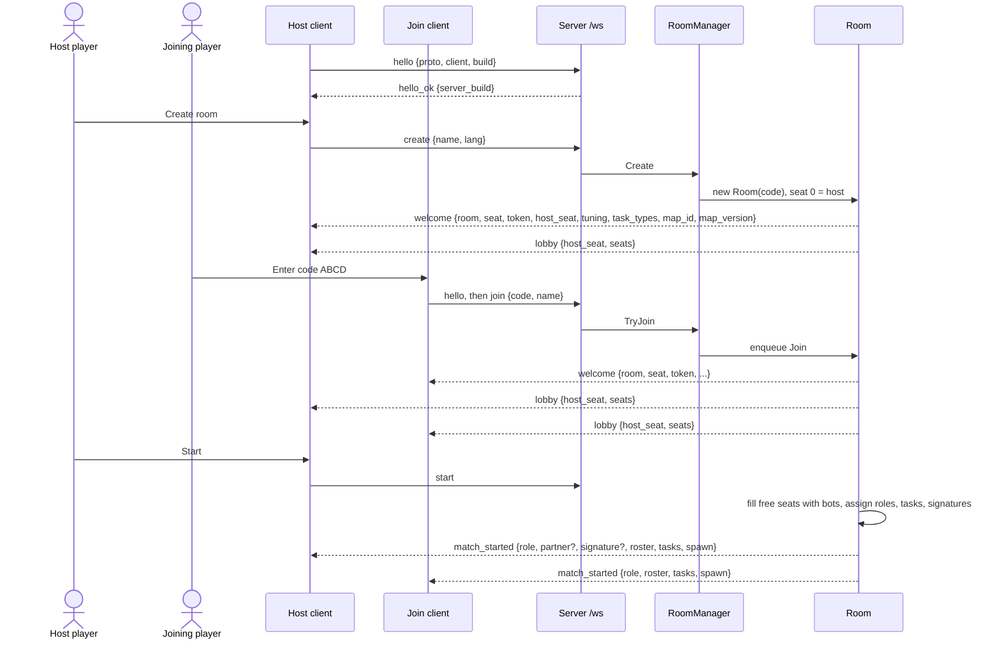

## 2. Movement and snapshots

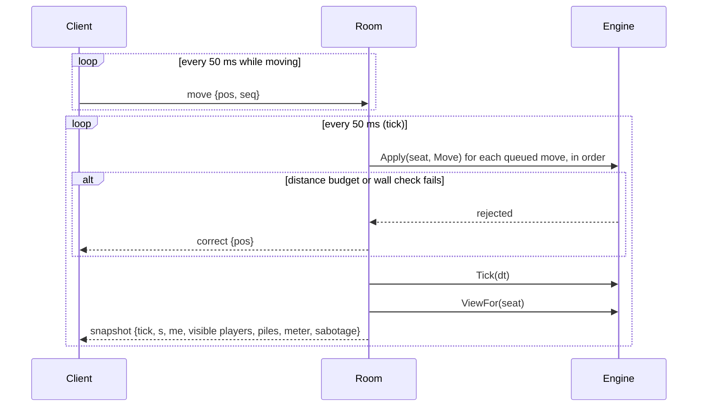

## 3. Doing a task

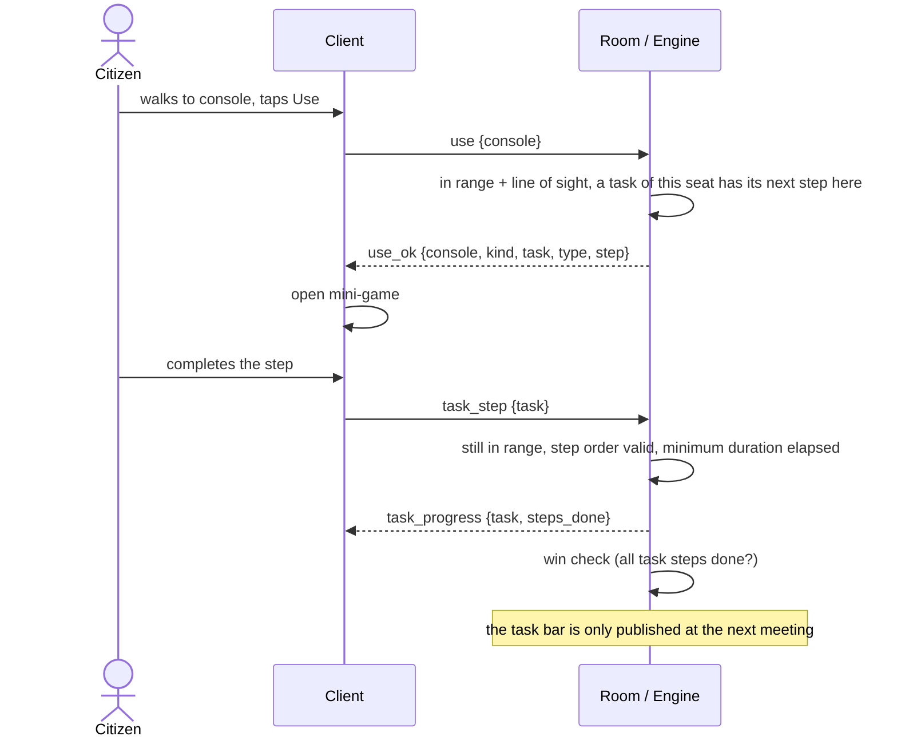

A polluter's fake task follows the same messages; the ledger simply does not count it.

## 4. Polluter hit (covert poison)

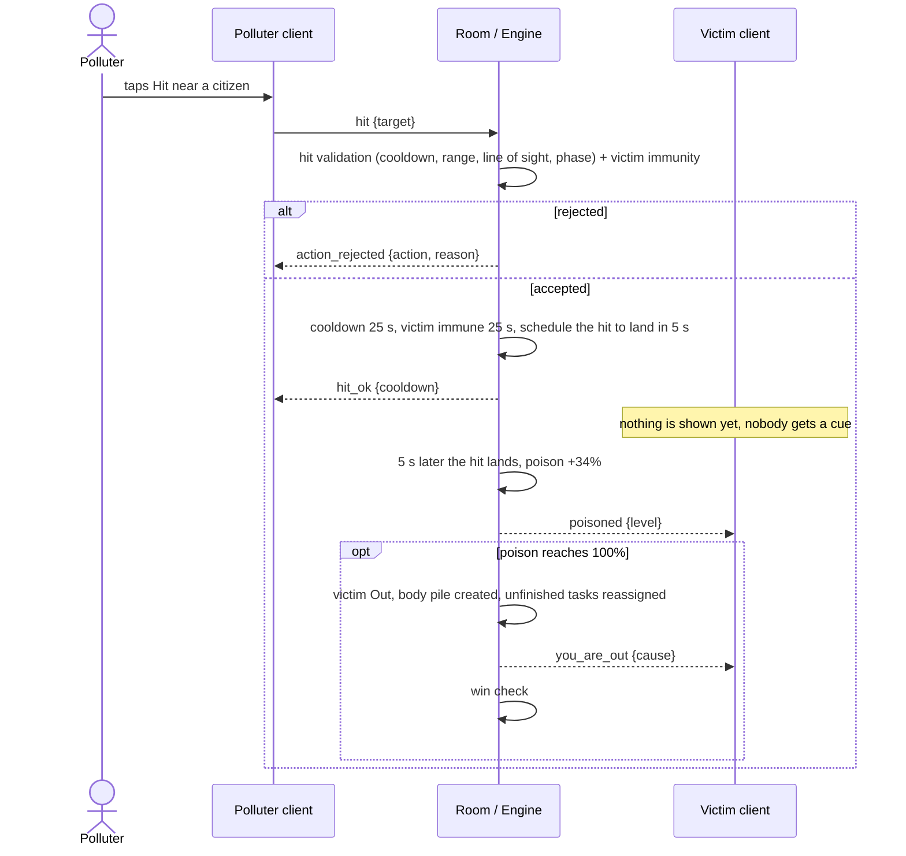

## 5. Dump and witnesses

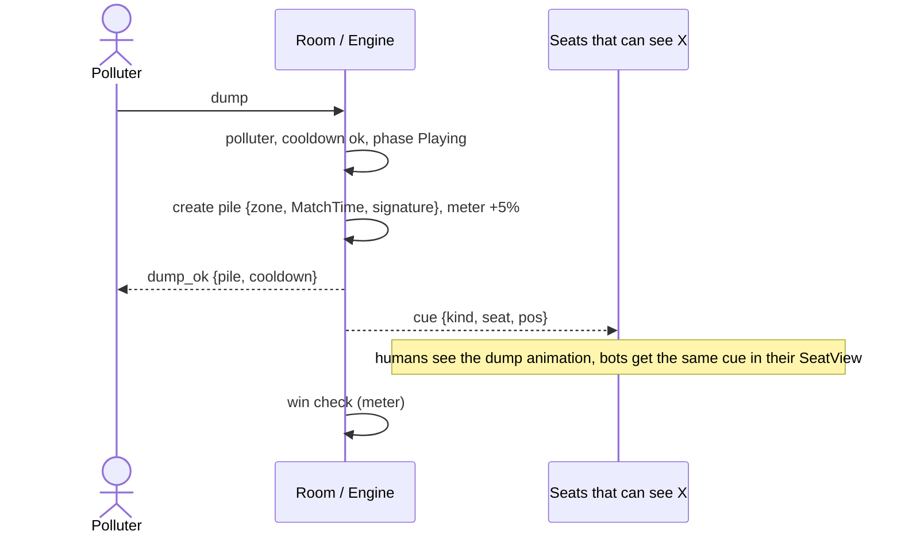

## 5b. Cleaning a pile

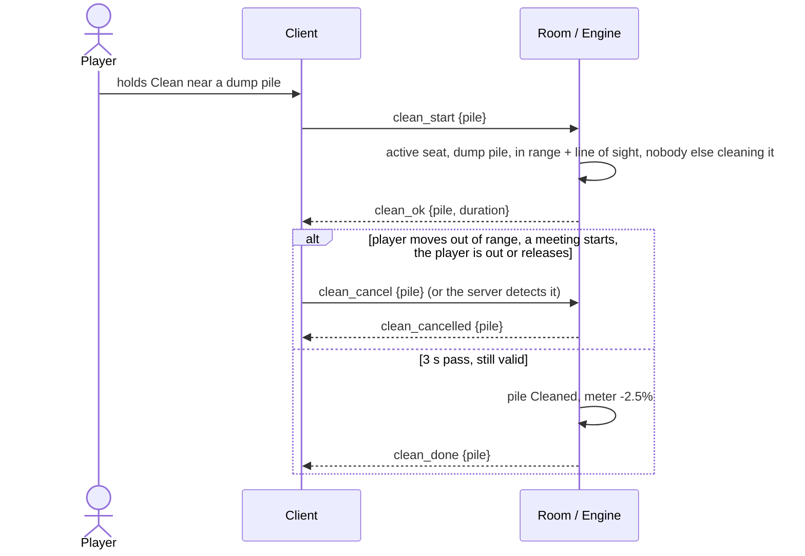

## 6. Report, meeting, vote, ejection

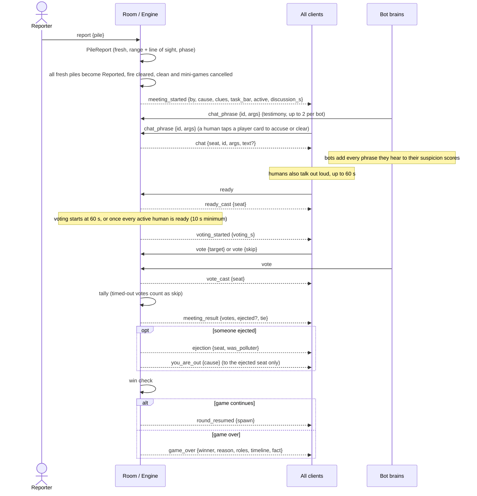

## 7. Sabotage: landfill fire

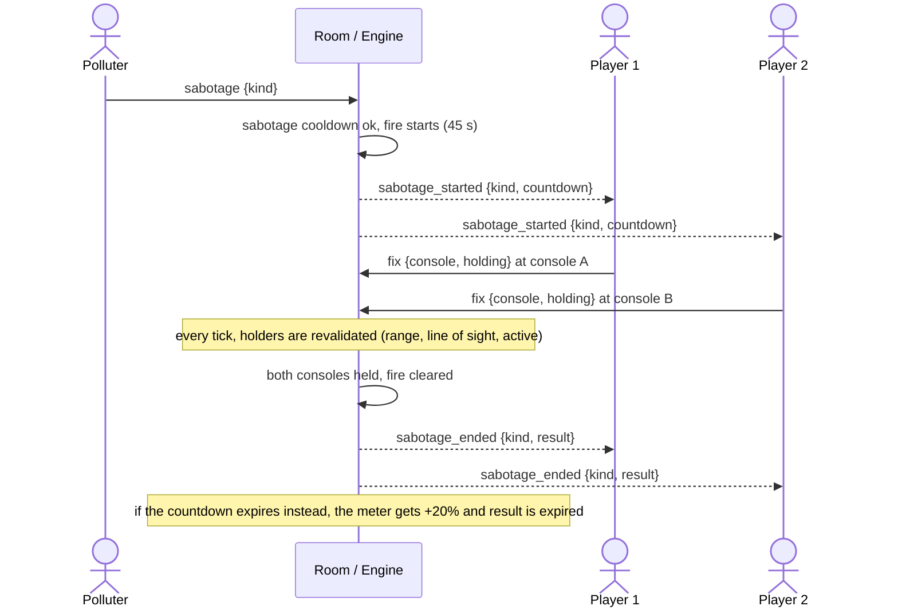

## 8. Disconnect, bot takeover, reconnect

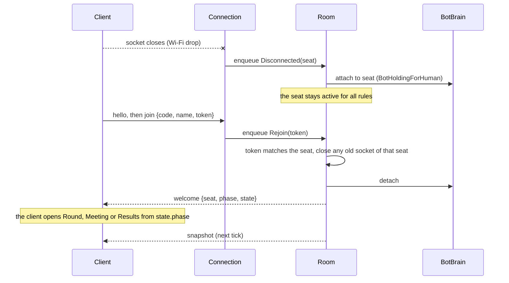

## 9. AI request with fallback

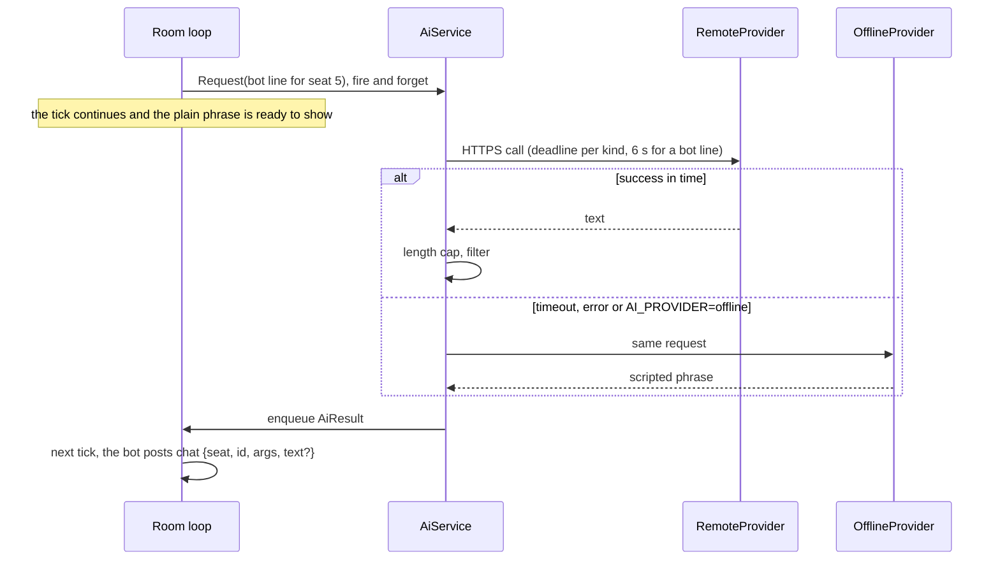

## 10. Game over and debrief

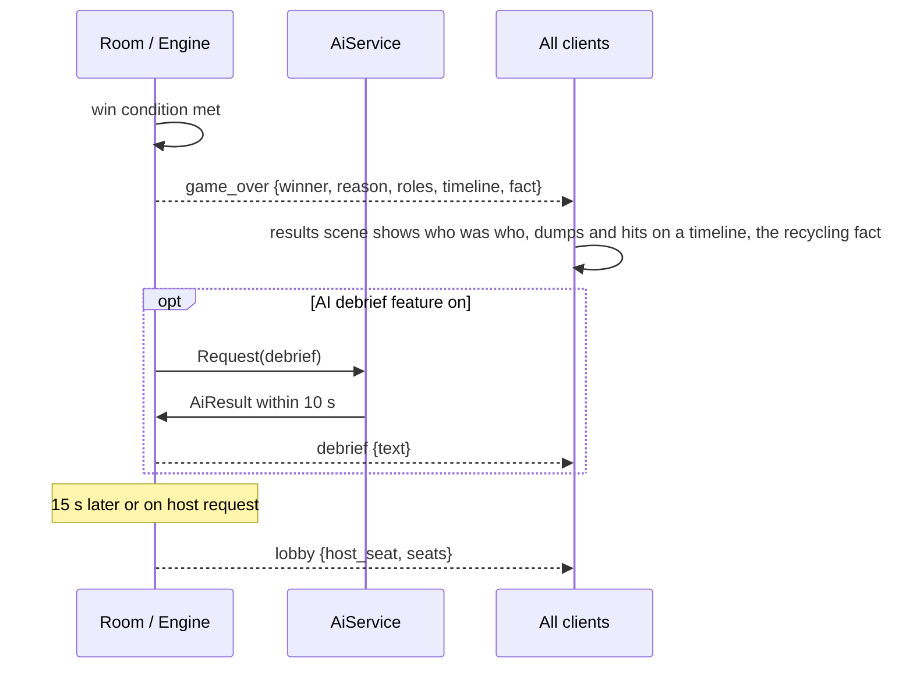
