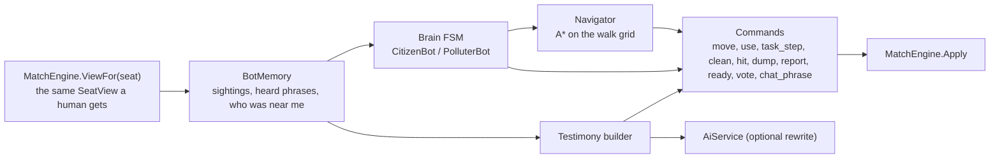
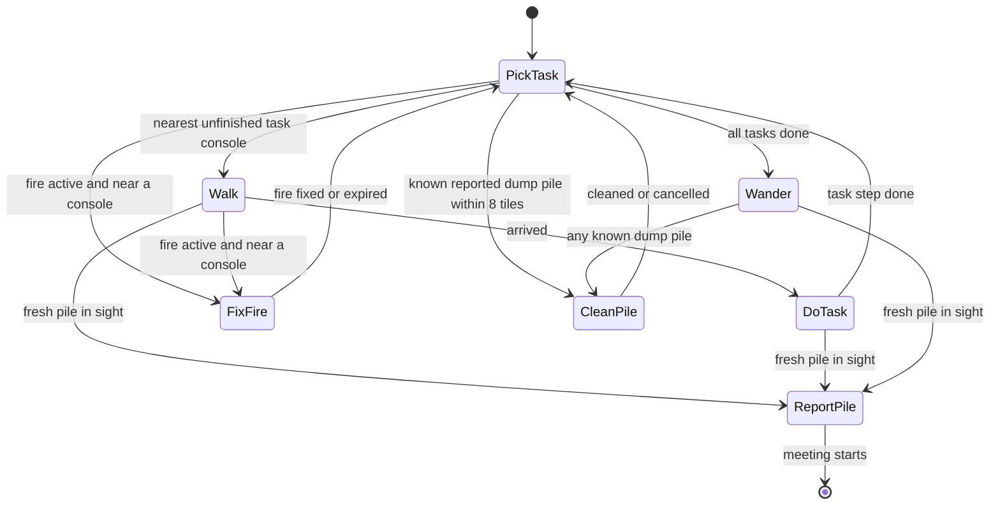
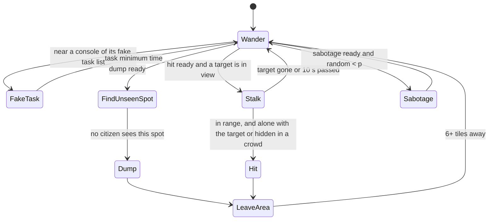
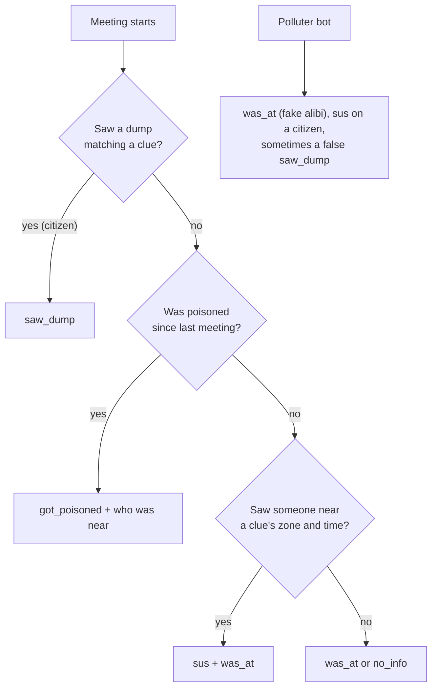
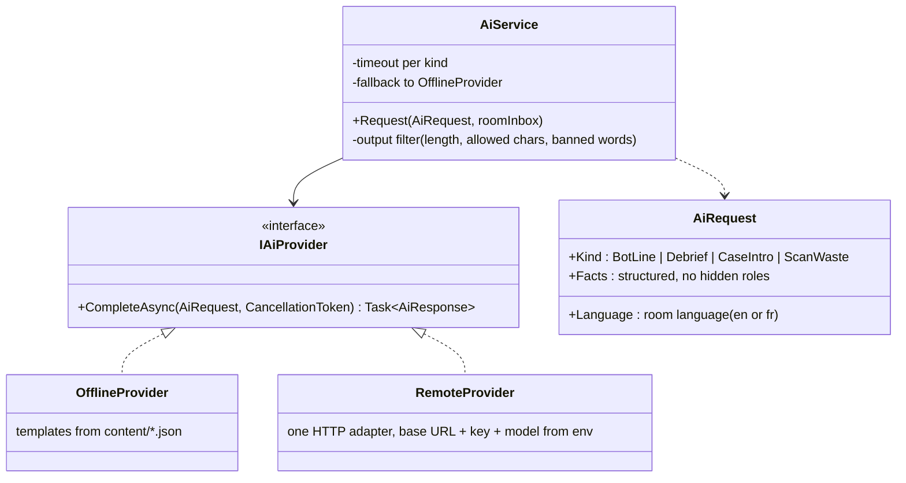

# 06 - Bots and AI

Bots fill the empty seats of every match (8 seats, so with 3 humans there are 5 bots). They must
be fair (no wallhacks), believable and cheap. AI (LLM) is an optional layer on top, never a
dependency.

Bots usually hold the **majority of the votes**. So the two things that decide whether a round
with judges is fun are: bots must act on what humans tell them (section 4), and bots must never
know more than a human in the same seat (section 1).

## 1. Bot architecture

Fairness rules:
- A bot reads **only its seat's `SeatView`**, the exact data a human client receives in
  `snapshot` and events. It never touches engine state. One filter serves bots and humans, so a
  hidden-information bug cannot favour either.
- Bots send the same commands as humans and pass the same validation.
- Human-like timing: reaction delay 0.4-1.2 s, walking at normal speed, tasks take the same
  minimum duration as for humans.
- Bots are shown as bots in the roster (`bot: true`). Hiding them would confuse judges, and a
  bot can still be a polluter.

## 2. Citizen bot

- Bots only know piles they have seen or that a meeting's clues named.
- Fire response: the room keeps a **console reservation** table; a bot reserves the free fire
  console nearest to it, so two bots never hold the same console.
- Every navigation goal has a time limit (path length / speed x 1.5 + 3 s); on timeout the bot
  drops the goal and picks the next one (no stuck bots).

## 3. Polluter bot

- "Unseen" = no active citizen has the spot within vision + line of sight, judged from the
  bot's own view, so it can be wrong, like a human. `FindUnseenSpot` tries 3 candidate spots for
  at most 12 s; if none works it goes back to `Wander` and retries after 5 s.
- Hits are covert (04 section 4), so the bot hits when it is alone with the target, or when at
  least two other seats are within hit range of the target (a crowd hides the attacker).
- The bot tracks the 25 s per-victim immunity (it reads the `target_immune` rejection).
- A polluter bot never reports its own piles and never votes for its partner.

## 4. Meetings: testimony, listening and voting

Phrases are ids with arguments; the client renders them in the player's language. **Humans use
the same phrases**: in the meeting screen, tapping a player card offers the accusation phrases.
Humans can also type a line (120 characters, 5 per meeting, word filter); the phrases are how they tell the bots.

| Phrase id | Args | Example (en) | Kind |
|---|---|---|---|
| `saw_dump` | who, zone | "I saw Green dumping near the river" | eyewitness accusation |
| `got_poisoned` | zone, who? | "I got poisoned at the market, Green was next to me" | victim accusation |
| `sus` | who | "Red is acting weird" | weak accusation |
| `with` | who, zone | "I was with Blue in the park" | alibi for someone |
| `was_at` | zone | "I was at the compost" | own alibi |
| `no_info` | - | "I didn't see anything" | filler |
| `skip` | - | "Let's skip, not enough proof" | filler |

What a bot says (at most 2 phrases per meeting, posted 2-8 s into the discussion):

How a citizen bot votes: it keeps a suspicion score per seat.

| Evidence | Points |
|---|---|
| Own eyes: saw this seat dump | 100 |
| Own memory: this seat was in hit range before the bot was poisoned | 35 per incident |
| Own eyes: this seat was in a clue's zone within 20 s of the clue's time | 30 |
| Signature link: a seat already scored for one pile, another pile has the same waste type | 20 |
| Heard `saw_dump` about this seat | 45 per accuser |
| Heard `got_poisoned` naming this seat | 30 per accuser |
| Heard `sus` about this seat | 15 per accuser |
| Own alibi: the bot was with this seat at the clue's time | -40 |

- Heard phrases count **once per accuser per target** for the whole match, and the heard total
  is capped at 90, so repeating a phrase adds nothing. Own evidence and heard evidence are
  stored separately.
- The bot votes for the top score if it is at least 40, otherwise it skips. So one eyewitness
  phrase from a human is enough to move bots, and a lying polluter can move them too. That is
  the game: other players counter with their own phrases and alibis.
- Bots tap Ready at once and vote 3-10 s into the voting stage.
- Polluter bot: never votes its partner; votes for the citizen with the most accusations,
  otherwise skips.
- `bots.skill` (0-1) in `tuning.json` scales reaction time and how often a bot notices things.

## 5. AI provider architecture

Rules:
- Only `AiService` knows a vendor. Swap vendors by changing `RemoteProvider` config, nothing else.
- Requests carry **structured facts** (who saw what, in which zone), never secret roles the
  speaking bot does not know, and never raw player text (there is none).
- Player names entering prompts are already sanitised (12 chars, `[A-Za-z0-9 _-]`).
- Output is capped (140 chars for bot lines), filtered, and replaced by the offline line if it
  fails the filter.
- AI text is written in the **room language** (the host's choice), because one line is shown to
  everyone.
- The game never waits. The offline line is always ready first; an AI result only replaces it
  if it arrives in time:

| Kind | When it is requested | Deadline | If late or failed |
|---|---|---|---|
| `BotLine` | At meeting start, for each bot phrase | 6 s | The plain phrase is shown |
| `Debrief` | At game over | 10 s (sent as `debrief` when ready) | The results screen keeps the template text |
| `CaseIntro` | While players sit in the lobby | before `start` | A scripted case is used |
| `ScanWaste` | On player request | 8 s | Manual picker |

- Use a small, fast model for `BotLine` (many short calls) and keep prompts short.

## 6. Candidate AI features and where they plug in

| Feature | Plugs into | Offline fallback | Extra platform needs | Effort |
|---|---|---|---|---|
| Smart bots (perception, lying, voting) | `Bots/*` | Itself is offline | none | Core work anyway |
| Natural-language bot testimony | Testimony -> `BotLine` | phrase templates | none | Small |
| Eco-coach debrief | `game_over` -> `Debrief` | `facts.json` + template | none | Small |
| Fresh case each round (story, zone names, motive) | lobby -> `CaseIntro` | scripted cases | none | Medium |
| Waste scanner (photo -> material + bin) | client camera -> `/scan` -> `ScanWaste` | manual picker | Android `CAMERA`; web camera needs HTTPS and is unproven in Godot web | Large, spike first |

Recommendation for the team decision: smart bots are already in the plan, so the cheapest
visible AI win is **natural-language testimony + eco-coach debrief**, both on the same
`AiService` path. In the pitch, the bots themselves are the main AI story: they see, remember,
lie and listen to people.
