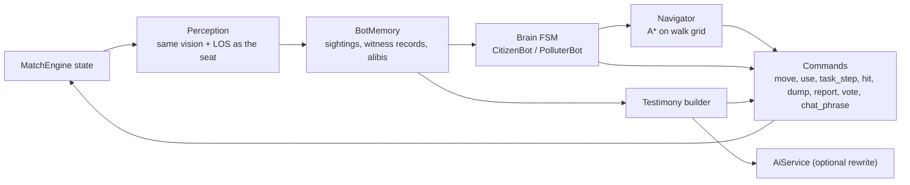
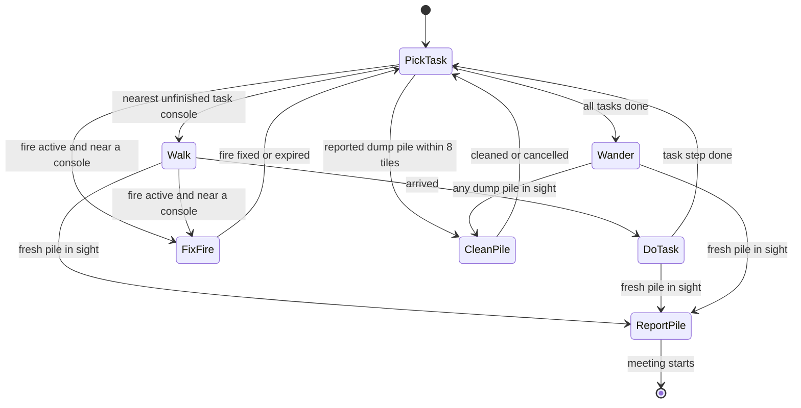
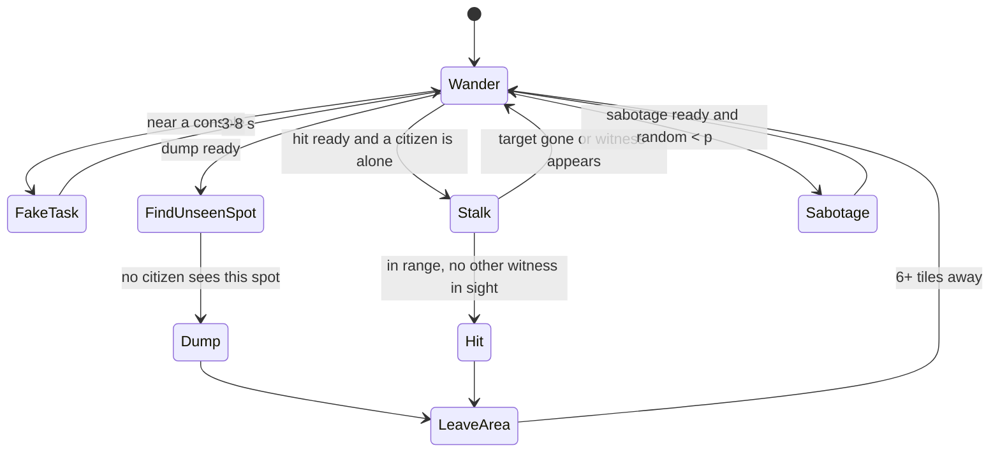
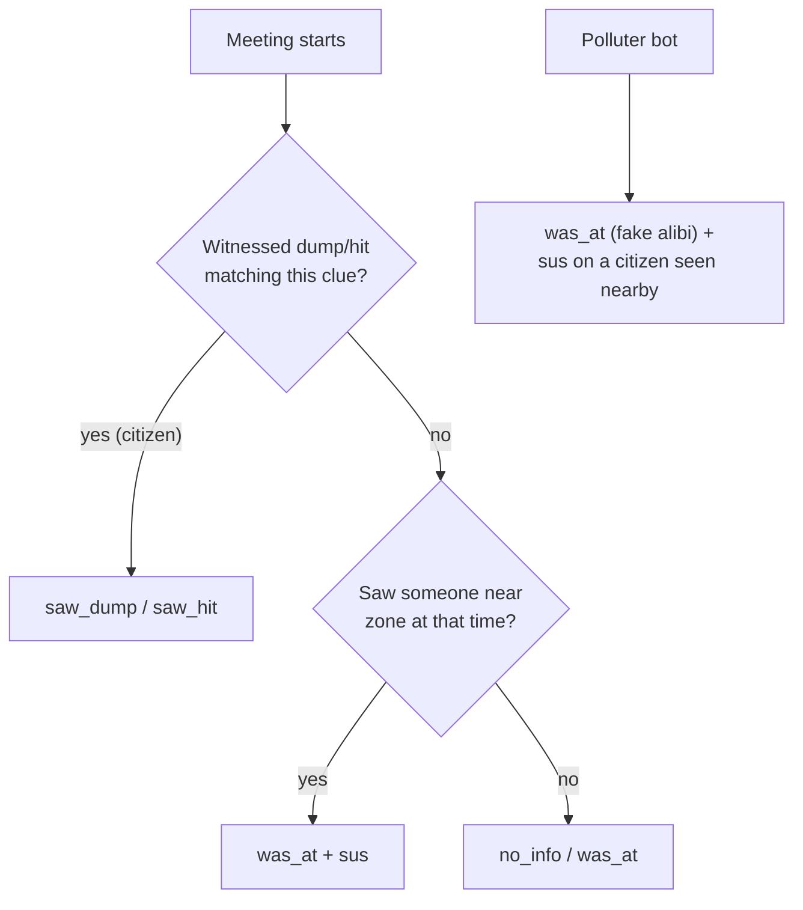
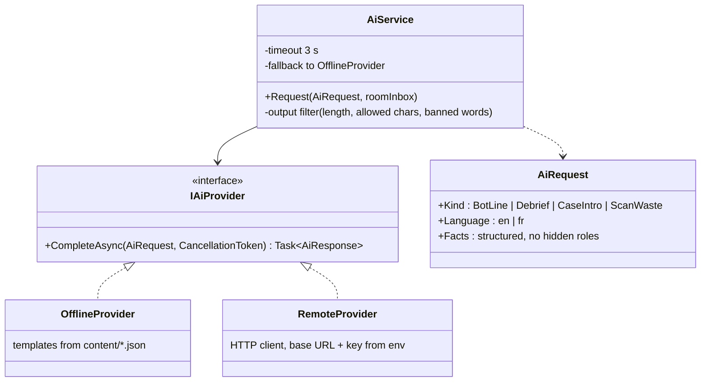

# 06 - Bots and AI

Bots fill the empty seats of every match (8 seats, so with 3 humans there are 5 bots). They must
be fair (no wallhacks), believable and cheap. AI (LLM) is an optional layer on top, never a
dependency.

## 1. Bot architecture

Fairness rules:
- A bot only knows what a human in that seat would know: what is inside its vision radius with
  line of sight, its own role, and (polluter) its partner. It never reads hidden state.
- Bots send the same commands as humans and pass the same validation.
- Human-like timing: reaction delay 0.4-1.2 s, walking at normal speed, tasks take the same
  minimum duration as for humans.

## 2. Citizen bot

- Fire response: the room keeps a **console reservation** table; a bot reserves the free fire
  console nearest to it, so two bots never hold the same console.
- Every navigation goal has a time limit (path length / speed x 1.5 + 3 s); on timeout the bot
  drops the goal and picks the next one (no stuck bots).

## 3. Polluter bot

"Unseen" = no active citizen has the spot within vision + LOS (computed from the bot's own
perception, so it can be wrong, like a human). `FindUnseenSpot` tries 3 candidate spots for at
most 12 s; if none works it goes back to `Wander` and retries after 5 s. `Stalk` gives up after
10 s. Bots respect the 25 s per-victim immunity (they read the `target_immune` rejection).

## 4. Testimony and voting

Testimony is a short list of phrase ids with arguments; the client renders them in the
player's language.

| Phrase id | Args | Example (en) |
|---|---|---|
| `saw_dump` | who, zone | "I saw Green dumping near the river" |
| `saw_hit` | who, zone | "Green attacked someone at the market!" |
| `was_at` | zone, time | "I was at the compost at 2:10" |
| `with` | who, zone | "I was with Blue in the park" |
| `sus` | who | "Red is acting weird" |
| `no_info` | - | "I didn't see anything" |
| `skip` | - | "Let's skip, not enough proof" |

Vote policy (citizen bot): suspicion score per seat = **own** direct observation of a hit or
dump (100) + own sighting near a pile's zone around its time (30) + matching waste-type history
(40) + hearsay: accused by others, counted **once per accuser** per match (10 each, max 30).
Direct observations and hearsay are stored separately so repeated phrases never add up. Vote
the top score if >= 40, else skip. Polluter bot: never votes partner; votes the most-accused citizen,
else skip. A `bot_skill` tuning value (0-1) scales accuracy and reaction time.

## 5. AI provider architecture

Rules:
- Only `AiService` knows a vendor. Swap vendors by changing `RemoteProvider` config, nothing else.
- Requests carry **structured facts** (who saw what, in which zone), never secret roles the
  speaking bot does not know, and never raw player text (there is none).
- Player names entering prompts are already sanitised (12 chars, `[A-Za-z0-9 _-]`).
- Output is capped (140 chars for bot lines), filtered, and replaced by the offline line if it
  fails the filter.

## 6. Candidate AI features and where they plug in

| Feature | Plugs into | Offline fallback | Extra platform needs | Effort |
|---|---|---|---|---|
| Smart bots (perception, lying, voting) | `Bots/*` | Itself is offline | none | Core work anyway |
| Natural-language bot testimony | Testimony -> `BotLine` | phrase templates | none | Small |
| Eco-coach debrief | `game_over` -> `Debrief` | `facts.json` + template | none | Small |
| Fresh case each round (story, zone names, motive) | match start -> `CaseIntro` | scripted cases | none | Medium |
| Waste scanner (photo -> material + bin) | client camera -> `/scan` -> `ScanWaste` | manual picker | Android `CAMERA`; web camera needs HTTPS and is unproven in Godot web | Large, spike first |

Recommendation for the team decision: smart bots are already in the plan, so the cheapest
visible AI win is **natural-language testimony + eco-coach debrief**, both on the same
`AiService` path.
