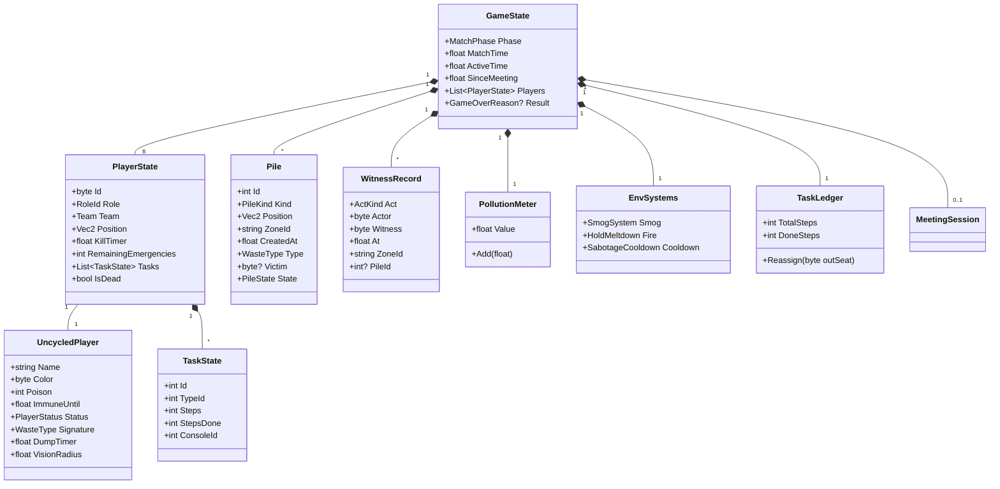
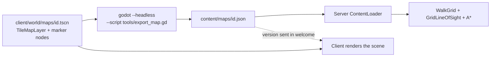

# 07 - Data Model and Content

## 1. Runtime data model (server, in memory)



`PlayerState`, `TaskState`, `MeetingSession`, `HoldMeltdown`, `SabotageCooldown` come from
`Sim` (renamed). `UncycledPlayer`, `Pile`, `WitnessRecord`, `PollutionMeter`, `SmogSystem`,
`TaskLedger` and the three clocks are new.
Nothing is persisted; a match is lost if the process restarts.

## 2. Content files (`content/`)

| File | Read by | Purpose |
|---|---|---|
| `tuning.json` | server (sends subset to client) | every gameplay number |
| `tasks.json` | server + client (via `welcome`) | task types, steps, category, durations |
| `maps/<id>.json` | server | walk grid, zones, consoles, spawns (exported from Godot) |
| `phrases.json` | server (bots) | phrase ids and their argument types |
| `facts.json` | server | real recycling facts for the debrief (with source URL) |
| `cases.json` | server | offline "fresh case" stories (if that AI feature is chosen) |

### 2.1 `tuning.json` (shape)

```json
{
  "version": 1,
  "seats": 8, "polluters": 2,
  "speed_tiles_per_s": 2.5,
  "vision": { "citizen": 4.0, "polluter": 5.0, "smog_min": 1.0 },
  "poison": { "per_hit": 34, "hit_range": 1.0, "hit_cooldown_s": 25, "start_cooldown_s": 10, "victim_immunity_s": 25 },
  "dump":   { "cooldown_s": 40, "meter_add": 5, "clean_meter_sub": 2.5, "clean_s": 3 },
  "meter":  { "passive_per_s": 0.08, "fire_expired_add": 20 },
  "match":  { "deadline_s": 600 },
  "meeting":{ "discussion_s": 60, "voting_s": 30, "results_s": 5, "emergencies_per_match": 2, "emergency_min_since_meeting_s": 15, "missed_vote_is_skip": true },
  "task_bar": "meetings_only",
  "visibility": { "lost_sight_grace_s": 0.3 },
  "sabotage": { "shared_cooldown_s": 30, "fire_countdown_s": 45 },
  "tasks":  { "common": 1, "short": 2, "long": 1 },
  "bots":   { "skill": 0.6, "reaction_min_s": 0.4, "reaction_max_s": 1.2 }
}
```

### 2.2 `tasks.json` (shape)

```json
{
  "tasks": [
    { "type": "sort_waste",   "category": "short",  "steps": 1, "min_s": 4, "consoles": ["market_bins"] },
    { "type": "turn_compost", "category": "long",   "steps": 2, "min_s": 6, "consoles": ["garden_compost", "garden_tap"] }
  ]
}
```

### 2.3 `maps/<id>.json` (exported, never hand-edited)

```json
{
  "id": "neighbourhood_01", "version": "sha1-of-scene",
  "tile_px": 32, "width": 60, "height": 40,
  "walk": "base64 bitset, 1 = walkable, row-major",
  "zones":    [ { "id": "market", "name_key": "zone_market", "rect": [10, 4, 12, 8] } ],
  "consoles": [ { "id": "market_bins", "kind": "task", "pos": [14.5, 7.0], "range": 1.2 } ],
  "special":  [ { "id": "meeting_button", "kind": "emergency", "pos": [30, 20] },
                { "id": "fire_a", "kind": "fire_fix", "pos": [5, 30] },
                { "id": "fire_b", "kind": "fire_fix", "pos": [55, 30] },
                { "id": "smog_panel", "kind": "smog_fix", "pos": [40, 5] } ],
  "spawns":   [ [30, 18], [31, 18], [32, 18], [30, 19], [31, 19], [32, 19], [30, 20], [32, 20] ],
  "walls_los": "base64 bitset, 1 = blocks sight"
}
```

## 3. Map pipeline



- Marker nodes in the scene (`Console`, `Spawn`, `Zone`, `FireFix`...) carry ids as metadata.
- The client compares the map `version` from `welcome` with its own scene's export version and
  shows "please update" on mismatch.
- CI fails if `content/maps/*.json` is older than its `.tscn` (re-export forgotten).

## 4. Text and languages

- All player-facing text lives in `client/i18n/strings.csv` (`keys,en,fr`).
- The server never sends display text, only keys and arguments (`zone_market`, `saw_dump`),
  except AI-generated lines, which are generated directly in the player's chosen language.
- Recycling facts: `facts.json` holds `{id, en, fr, source}`; the debrief shows one fact by id.
