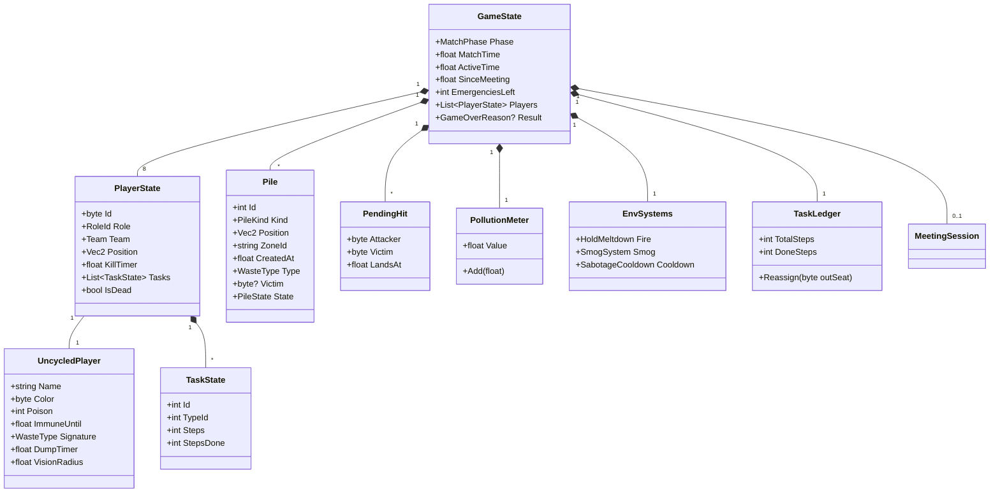
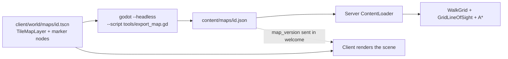

# 07 - Data Model and Content

## 1. Runtime data model (server, in memory)



- `PlayerState`, `TaskState`, `MeetingSession`, `HoldMeltdown`, `SabotageCooldown` come from
  `Sim` (renamed). The rest is new.
- "Out" is `PlayerState.IsDead = true`. `KillTimer` is the hit cooldown.
- `TaskState.Id` must be **unique within the match** (the vendored assigner numbers tasks per
  player from 0; `TaskLedger` renumbers them) because tasks can move between seats.
- `TaskState.TypeId` is the catalog entry id; the entry gives the mini-game type and consoles.
- There is no server-side witness list any more: what a bot saw lives in that bot's own memory,
  filled from its `SeatView`.
- Nothing is persisted; a match is lost if the process restarts.

## 2. Content files (`content/`)

The **server** reads these files. The client never reads them from disk; it gets what it needs
in `welcome` (`tuning`, `task_types`), so the two sides cannot disagree.

| File | Purpose |
|---|---|
| `tuning.json` | every gameplay number |
| `tasks.json` | task catalog: entries, mini-game type, steps, category, consoles |
| `maps/<id>.json` | walk grid, zones, consoles, spawns (exported from Godot) |
| `phrases.json` | phrase ids and their argument types |
| `facts.json` | real recycling facts for the debrief, each with a source URL |
| `bots.json` | bot names and colours |
| `cases.json` | offline "fresh case" stories (only if that AI feature is chosen) |

### 2.1 `tuning.json` (shape; values explained in 04)

```json
{
  "version": 1,
  "seats": 8, "polluters": 2,
  "speed_tiles_per_s": 2.5,
  "vision": { "citizen": 4.0, "polluter": 5.0, "smog_min": 1.0, "margin": 0.5, "lost_sight_grace_s": 0.3 },
  "poison": { "per_hit": 34, "hit_range": 1.8, "hit_cooldown_s": 25, "start_cooldown_s": 10,
              "victim_immunity_s": 25, "land_delay_s": 5 },
  "dump":   { "cooldown_s": 40, "start_cooldown_s": 10, "meter_add": 5, "clean_meter_sub": 2.5, "clean_s": 3 },
  "meter":  { "passive_per_s": 0.2, "fire_expired_add": 20 },
  "match":  { "intro_s": 5, "safety_cap_s": 900 },
  "meeting":{ "discussion_s": 60, "discussion_min_s": 10, "voting_s": 30, "results_s": 5, "ejection_s": 4,
              "emergencies_per_match": 2, "emergency_min_since_meeting_s": 15, "report_range": 3.0 },
  "sabotage": { "start_cooldown_s": 10, "cooldown_s": 30, "fire_countdown_s": 45, "smog_fix_s": 3 },
  "tasks":  { "common": 1, "short": 2, "long": 1 },
  "movement": { "budget_refill_factor": 1.2, "budget_cap_tiles": 3.0 },
  "bots":   { "skill": 0.6, "reaction_min_s": 0.4, "reaction_max_s": 1.2 }
}
```

### 2.2 `tasks.json` (shape)

An **entry** is one mini-game type at one place. Two mini-game types are enough for the first
playable, as long as there are at least 1 common, 2 short and 1 long entries (more is better, so
citizens do not all queue at the same console).

```json
{
  "entries": [
    { "id": 1, "type": "sort_waste",   "category": "common", "steps": 1, "min_s": 4, "consoles": ["square_bins"] },
    { "id": 2, "type": "sort_waste",   "category": "short",  "steps": 1, "min_s": 4, "consoles": ["market_bins"] },
    { "id": 3, "type": "sort_waste",   "category": "short",  "steps": 1, "min_s": 4, "consoles": ["school_bins"] },
    { "id": 4, "type": "turn_compost", "category": "short",  "steps": 1, "min_s": 5, "consoles": ["garden_compost"] },
    { "id": 5, "type": "turn_compost", "category": "long",   "steps": 2, "min_s": 6, "consoles": ["farm_compost", "farm_tap"] }
  ]
}
```

`consoles[i]` is where step `i` is done. `welcome.task_types` is this list.

### 2.3 `maps/<id>.json` (exported, never hand-edited)

```json
{
  "id": "neighbourhood_01", "version": 3, "source_sha1": "sha1 of the .tscn file",
  "tile_px": 32, "width": 60, "height": 40,
  "walk": "base64 bitset, 1 = walkable, row-major",
  "sight": "optional base64 bitset, 1 = blocks sight; defaults to the non-walkable cells",
  "zones":    [ { "id": "market", "name_key": "zone_market", "rect": [10, 4, 12, 8] } ],
  "consoles": [ { "id": "market_bins", "kind": "task", "pos": [14.5, 7.0], "range": 1.2 },
                { "id": "meeting_button", "kind": "emergency", "pos": [30.0, 20.0], "range": 1.5 },
                { "id": "fire_a", "kind": "fire_fix", "pos": [5.0, 30.0], "range": 1.2 },
                { "id": "fire_b", "kind": "fire_fix", "pos": [55.0, 30.0], "range": 1.2 },
                { "id": "smog_panel", "kind": "smog_fix", "pos": [40.0, 5.0], "range": 1.2 } ],
  "spawns":   [ [30, 18], [31, 18], [32, 18], [30, 19], [31, 19], [32, 19], [30, 20], [32, 20] ]
}
```

## 3. Map pipeline



- Marker nodes in the scene (`Console`, `Spawn`, `Zone`) carry ids as metadata.
- **Collision must be grid-aligned.** Whatever blocks walking must fill whole tiles, in the
  tile layer the export tool reads. A decoration with its own odd-shaped collider would let the
  client stand where the server's grid says "wall", and the server would keep snapping the
  player back. The player's collider is a circle of radius 0.3 tile.
- The export tool bumps `version` and writes it both into the JSON and into the scene's
  metadata. The client compares its scene's version with `map_version` from `welcome` and shows
  "please update" on mismatch.
- CI recomputes the SHA-1 of each `.tscn` and fails if it differs from `source_sha1` in the JSON
  (a forgotten re-export). This check needs no Godot install.

## 4. Text and languages

- All player-facing text lives in `client/i18n/strings.csv` (`keys,en,fr`).
- The server never sends display text, only keys and arguments (`zone_market`, `saw_dump`).
  The exceptions are the lines humans type (`chat.text`: as typed, in any language, with English words from `content/chat_filter.json` replaced by `***`, shown as plain text) and AI-written text (`debrief.text`), written in the **room
  language** chosen by the host, because everyone in the room reads the same line.
- Recycling facts: `facts.json` holds `{id, en, fr, source}`; the debrief shows one fact by id.
  Prefer facts about Tunisia and Sweden (the event is Swedish-Tunisian), each with a checkable
  source.
