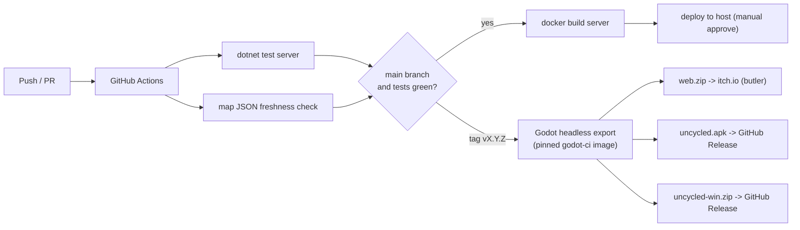

# 09 - Deployment, Builds, Operations

## 1. Environments

| Env | Server | Client builds | Used for |
|---|---|---|---|
| Local | `dotnet run --project server/Uncycled.Server` on `:5000` | Godot editor run, URL `ws://localhost:5000/ws` | daily dev |
| LAN test | same, on a laptop | APK / Windows / web served from the laptop | multi-device tests, plan B2 rehearsal |
| Production | container on the chosen host, 1 instance, `wss://<host>/ws` | itch.io web, GitHub Releases (APK, Windows zip) | playtests and the event |

## 2. Hosting choice (open decision)

| Option | WebSocket + TLS | Always on, 1 instance | Cost | Notes |
|---|---|---|---|---|
| Fly.io (Paris `cdg` region) | yes | yes (`min_machines_running = 1`, no auto-stop) | low, card needed | Recommended: close to Tunisia, simple Docker deploy |
| Render | yes | paid plan to avoid sleep; set 1 instance | free tier sleeps | Free tier unfit for the demo |
| Railway | yes | yes | small monthly fee | Fine alternative |
| VPS + Caddy | yes (Caddy auto-TLS, needs a domain) | yes | low | Most control, most setup |

Whatever the host: one instance only (rooms are in memory), region in Europe, `/health` probe.
The Docker build context is the **repo root** (`docker build -f server/Dockerfile .`), because
the image must contain `content/` as well as `server/`.

Web build host: itch.io (set the page to "mobile friendly" and landscape) or GitHub Pages.
Both work because the web export has threads off and needs no special headers.

## 3. Build pipeline

Exports can run locally first (`AGENTS.md` section 9 commands); CI export is a P6 nicety.

## 4. Versioning

| Version | Where | Rule |
|---|---|---|
| Protocol version (int) | `docs/protocol.md`, server constant, client constant | Bump on any breaking message change; mismatch -> "please update" |
| Game version (semver) | `project.godot` + server assembly | Tag `vX.Y.Z` builds releases |
| Map version | map JSON `version` | Must match between client scene and server JSON |
| Build id | git short SHA in `/health` and the client menu footer | Lets testers report exactly what they ran |

## 5. Observability

- Server: structured console logs (room, seat, event, ms); `/stats` (rooms, connections, tick
  time p95, messages/s); warning if a tick takes > 30 ms.
- Client: debug overlay (F3 or 3-finger tap): FPS, ping, snapshot age, seat, build id.
- Playtests: a `match_summary` log line at game over (duration, winner, reason, dumps, hits,
  meetings, bots count) to tune numbers.

## 6. Demo-day runbook

| When | Action |
|---|---|
| Day before | Deploy final server; `/health` ok; install APK on spare phones; Windows zip on 2 laptops; open the web build on an Android and an iPhone; print the QR code of the web link |
| 30 min before | Wake server (`/health`), create a test room, 3-device smoke round |
| During | Show the QR of the web link and the 4-letter room code on a laptop screen; spare phones ready for judges without a working browser |
| If Wi-Fi fails | Plan B1: hotspot / mobile data. Plan B2: laptop server + hotspot, devices set `ws://<ip>:5000` in Settings |
| If server misbehaves | Restart the container (rooms are lost, start a new one); fall back to B2 |
| After | Save logs (match summaries) for the pitch numbers |
